# SIMPLware Release Notes

## In scope
- SIMPL UIs: Flo and Puls
- SIMPL Kotlin and Python backend services
- SIMPL Kotlin, Python, and Flutter SDKs
- Robot firmware

## Out of scope
- Software infrastructure
- Robot mechanics
- Layout and physical infrastructure

> **NOTE**: SIMPL clickable ticket links look like this: [#1234], and initiative links look like this: [#1234]

# v3.2.1 - PIN it to win it

2026.11.20

## ✨ Shiny new stuff
### 🔑 Sign in to Flo without a Microsoft account [#9220] [#9331]
Sites can now add **Flo users with no Microsoft account**!

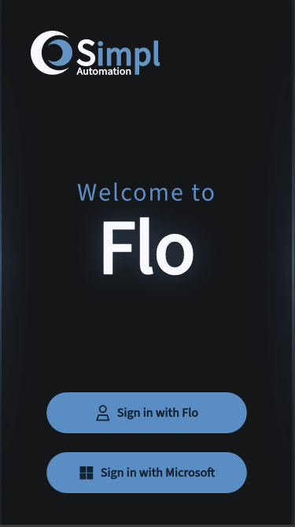

- **Flo admins** can create, update, disable and reset the PIN for local users [#9222]
- Local users sign in to Flo with a **username and PIN**
  - Local users are given a **temporary PIN** that must be changed at **first sign-in** [#9223] [#9225]
- Sign-in details are **encrypted end to end**, so no password, PIN or token travels in the clear [#8396] [#9221] [#9225]

### 💾 Redis resilience [#8779]
Site data can now be **restored** after **full data loss**!

- The system takes **nightly snapshots** of its live data and can be **restored** from any of them [#9093] [#9094] [#9095] [#9096]
- **Inventory state** can be rebuilt from Puls events [#9097]
- A **disaster recovery runbook** and **restore drills** keep the team ready [#9099] [#9100] [#9101]

## ⏫ Level-ups
### ⚡ Snappier SIMPLware [#9152]
The system **visibility layer** that feeds Flo now runs on **its own Redis database**, taking load off the **main Redis** so the **whole system** lags less!

### 🚨 Problems caught before you notice [#8994]
The team now gets **alerts** the moment a **site's servers** run into trouble, with **dashboards** and **runbooks** to fix it fast! [#9159] [#9160] [#9161] [#9162] [#9163] [#9164] [#9165] [#9167] [#9168]

### 🔄 Rotate totes in place with Flo teleport [#9112]
Teleport a tote to **its own spot** in Flo to **rotate it in place**!

## 🪲 Bug fixes
- Flo screens no longer stall for a moment every few minutes on busy sites [#9257]
- Signing in to Flo with Microsoft for the first time no longer times out after clearing the cache [#9332]
- Marking a tunnel accessible in Flo now takes effect right away instead of timing out after about two minutes [#9297] [#9341]
- After moving a Mantis to a DM code in Flo, more moves from the Robot Detail screen go through without leaving and reopening it [#9348]
- Blocked totes and shelves in Flo show "Blocked by" again, and a manual Mantis extract asks to remove the blocking tote first [#9343] [#9347]
- Container search in Flo now shows only the container you searched for, in number order [#9340]
- Workstation cards on the Workstations screen now show how full each workstation is, use the same red icons as the Workstation Detail screen, and open into it smoothly [#9195]
- The Demand Detail screen now counts Unconstrained and Constrained by demand type like its other counts, and tapping the workstation name opens the Workstation Detail screen [#9195] [#9194]
- Totes teleported to the orphanage now show the orphanage as their parent container on the Container Detail screen [#9263]
- Inaccessible tunnels now show on the shelf and tote screens with the tunnel's name instead of the shelf's [#9288]
- Containers on the Flo teleport bottom sheet now load every time without restarting Flo [#9264]
- Buttons on Flo bottom sheets, like the Containers screen filter buttons, are no longer hidden behind the Android navigation bar [#9291]
- Opening a container or tote's Detail screen in Flo now double-checks it right away [#9227]
- A Mantis is no longer reported as finishing a task it never finished, which left totes in the P&D while Flo showed them on the robot [#9299] [#9300]
- MOM now plans Mantis moves faster [#9290]

## 💽 Firmware updates
No firmware updates required! ✅

## 🧪 Development improvements
- Groundwork for support tickets from local Flo users, so they reach support with the user's name once support tickets roll out [#9226]
- Services now fail in about 20 seconds with an honest log line when Redis is down, instead of 42 to 84 seconds [#9234]
- AMS now logs the command set it sends to a robot [#9351]

## 🚧 Known issues
- Flo's Extract on the Robot Detail screen accepts a shelf location instead of a tote ID, and the robot then pulls out the shelf itself [#8866]
- Robots can sometimes stay offline after a short 4G drop until they're power cycled [#8313] [#8199] [#8411]
- Ants can sometimes form 4-way gridlocks [#8109]
- After converting multi-compartment totes to 1-compartment, empty 1-compartment totes often aren't brought to decant workstations [#8667]
- After RVS starts, some Mantis robots can appear without bay assignments until statuses catch up [#8599]
- CTS sometimes takes a long time to update container tags [#6576]
- An Ant's battery level can jump up or down when it connects to or leaves a charger [#8383]
- Workstations sometimes show as Off on the Flo Workstation and Workstation Detail screens when Tote Induction is enabled [#7779]
- Ants never show in "Moving" state [#7294]
- The on-screen keyboard cannot be used during Flo Tote Induction [#7907]
- Pressing Escape on the Flo Tote Induction screen does not return to the Workstation Detail screen when the tote label field has focus [#8342]
- On the Flo Containers screen, when lots of filters are selected, there is no room on smaller screens for the tote cards [#7851]
- Old robot logs aren't always cleaned up, so a robot's SD card can fill and stop saving new logs [#8995]

## 🚀 Deployment notes
- **New robot firmware?** NO
- **New Flo APK?** YES (5.0.16)
- **New backend services:** NONE
- **Updated backend services:** AMS, AVS, CVS, IMS, LVS, MOM, RMS, RVS, SSS, SVS, TOM, USA
- **Database migrations:** USA marks all existing users as Microsoft users at startup (runs automatically, safe to rerun) [#9222]
- **Helm configuration changes:**
  - Each site needs its own login key pair and sign-in settings for USA and SSS [#9224]
  - New nightly Redis backup CronJob; the Blob Storage IP whitelist must allow the cluster [#8779] [#9093] [#9094]
  - Deploy the new redis-ui chart first, then set the UI_REDIS_* and replica settings [#9205]
  - On-site Flo access works now over HTTPS; no more need to use port-forwarding when on-site [#9158]
  - Flo now waits for the robot on each manual Mantis and ant task; the new `ctRobotManualTask` timeout (7000 ms by default) is set in the flo and flo-local charts, so no per-site action is needed [#9348]
- **Downtime requirements:** 2 hours full system downtime

# v3.2.0 - Totes amazing

2026.11.11

## 🔥 Hotfix v3.2.0.4 [#9199]

2026.11.16

### 🪲 Bug fixes
- Flo screens no longer fall behind on area demand during a burst of orders [#9201]
- Area demand that hasn't changed is no longer resent over and over, cutting load on the system [#9170]
- Ants no longer wait as long for their next task during busy periods [#9196]
- Flo no longer misses tote and container situation updates when many are published at once [#9228] [#9229]
- The Tote Detail screen no longer shows tracking for workstations whose demand is already fulfilled [#9189]
- Applying a level offset now replaces the existing offset instead of adding to it, and new access-node offsets get the waterfall adjustment [#9231]

### 🚀 Deployment notes
- **New Flo APK?** YES (v5.0.8)
- **Updated backend services:** AVS, GAS, ITS, MOM, RQS, SVS
- **Helm configuration changes:** EMQX max inflight raised from 32 to 128 for emqx and bot-log-emqx (EMQX_MQTT__MAX_INFLIGHT=128, pods recreate on deploy) [#9229]
- **Preemptive Kafka memory increase:** Kafka broker memory request/limit raised from 4Gi/6Gi to 8Gi/8Gi for Locust Grove, Waltham and QA environments. [#9232]
- **Downtime requirements:** Safety zones must be enabled on all workstations for 5 minutes. Some system slowness will occur for 15 minutes during the deployment

## 🔥 Hotfix v3.2.0.3

2026.11.13

### ⏫ Level-ups
#### 📦 Tote Detail is easier to use [#9186]
Tote Detail now **shows more and jumps around less**!

- Inventory lines show the **full pack label**, description and quantity, and tapping a line copies the pack label
- Opening a compartment **no longer auto-scrolls** the page, and nothing opens on its own when you arrive
- Inventory now sits above Ancestry, and the Containers filters include **Inventory count** again
- Tote icons on container cards now match how the tote sits on the map

### 🪲 Bug fixes
- A tote whose only problem is a full destination is no longer shown as critical, and the full destination is listed only once [#9184]
- Tote constraint chips are now ordered red, then yellow, then white, and Demand fulfilled chips are white instead of yellow [#9185]
- Workstation cards on the Workstations screen now show the same requesting, in transit and at workstation counts as the Workstation Detail screen [#9183]

### 🚀 Deployment notes
- **New Flo APK?** YES (v5.0.7)
- **Downtime requirements:** None

## 🔥 Hotfix v3.2.0.2 [#9171]

2026.11.12

### ⏫ Level-ups
#### ⚡ No more slowdowns under heavy demand [#9180] [#9173] [#9175]
The site now **stays responsive under heavy demand**!

- Product-pack demand no longer overloads the system and slows down every service [#9180]
- Clearing finished demand no longer bogs the site down every few minutes [#9173]
- Background checks on containers, areas and situations now run less often and put less load on the system [#9175]

### 🪲 Bug fixes
- Stuck Ants are now cleared automatically, even when they never report that they've stopped moving [#9177]
- When auto-replan is turned off, Ants no longer replan on their own after a command fails or a Mantis fails [#9135] [#9136]
- Changing a Mantis bay assignment in Flo no longer times out while the update takes minutes to go through [#9140]
- Assigning new bays to a Mantis in Flo no longer shows a timeout after the change has already saved [#9176]
- Tote icons in Flo now show each tote's real compartments and orientation, and the tote detail minimap matches them [#9119]
- The Find container button has been removed from the Flo Containers screen [#9174]
- Flo's Containers detail screen is cleaner: the confusing "As of" heading is gone, and Verify now shows a spinner while it runs [#9174]

### 🚀 Deployment notes
- **New Flo APK?** YES (v5.0.4)
- **Updated backend services:** AMS, AVS, CTB, CVS, RMS, RVS, SVS, TOM
  - Scale TOM down (or use the Recreate strategy) so no old TOM pod is running when the new one starts; it clears and rebuilds its demanded-tote data on startup [#9173]
- **Downtime requirements:** 30 minutes full system downtime

## 🔥 Hotfix v3.2.0.1

2026.11.12

### 🪲 Bug fixes
- Container teleport in Flo no longer fails on every attempt due to not waiting long enough to download needed containers for selection [#9130]

### 🚀 Deployment notes
- **New Flo APK?** YES (v5.0.2)
- **Downtime requirements:** None

## ✨ Shiny new stuff
### 🔎 Dude, where's my tote? [#8338] [#8727] [#8728] [#8729] [#8730] [#8731] [#9022] [#9065] [#9077] [#7647]
Flo now has **better tracking** of totes and tote issues!

- A new **Tote constraints** page sorts every tote by severity (critical, warning, low, available) with filters and counts; its app-bar icon replaces the old inaccessible-tunnels alert

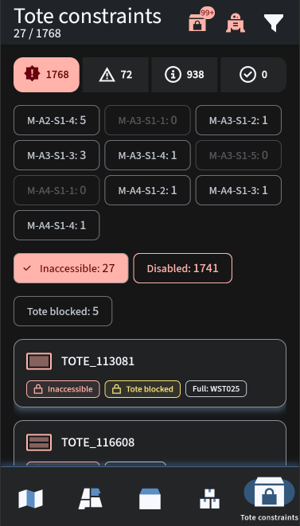

- Totes get colored **chips** for whatever is holding them back: Inaccessible, Disabled or Out of purview (red), Full, Overweight or Selected for (white), and Tote blocked (yellow)

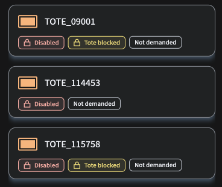

- **Tunnel and level details** show which robot and task made a tunnel inaccessible and why

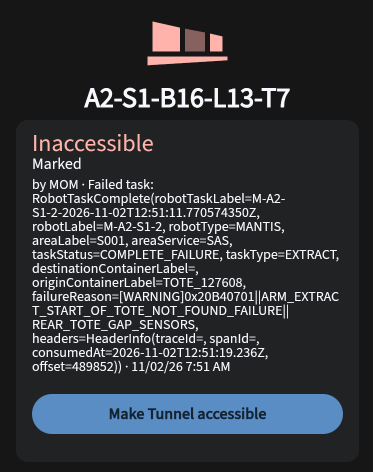

- The **Workstation Detail** screen's Tracking card shows each demand's **total, in transit and at workstation** counts

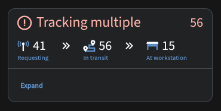

- The new **Demand Detail** screen lists the totes **in transit and at the workstation**, plus which totes in storage can and can't serve the demand and why

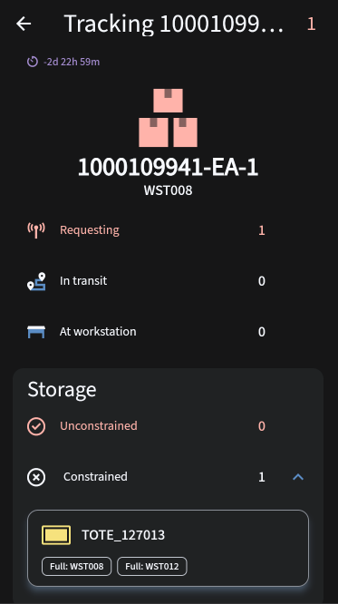

- The **Workstation Detail** screen shows how **full** the workstation is according to the SIMPL WIP calculation

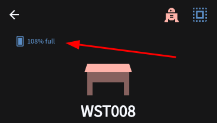

- The layout now has separate **Disabled tunnels** and **Inaccessible tunnels** toggles [#7647]

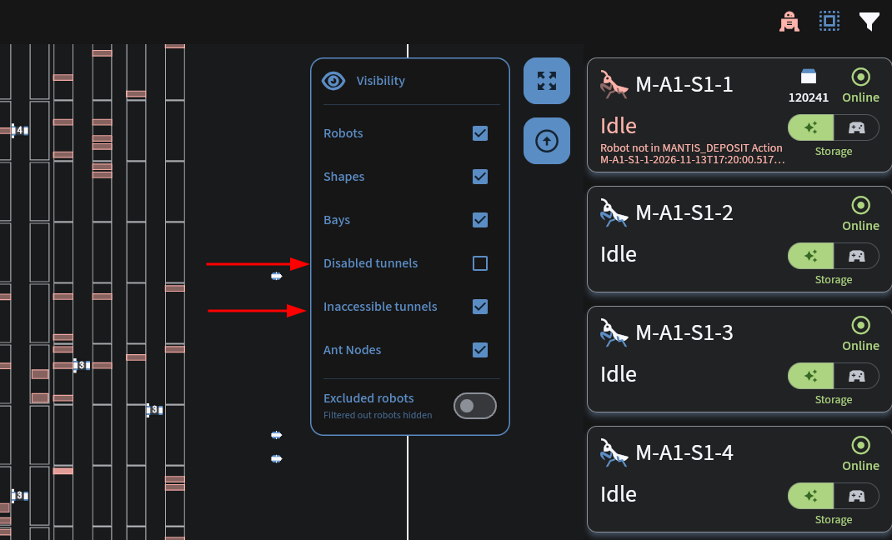

- **Mantis Detail** shows the Mantis's **next tote** based on the system's selection algorithm

### 🛍️ Inventory has come to Flo [#7805] [#8482] [#5788]
**Tote inventory** is now right there in Flo!

- A new **Inventory screen** and compartmented-tote icons and filters make it easy to find what's where

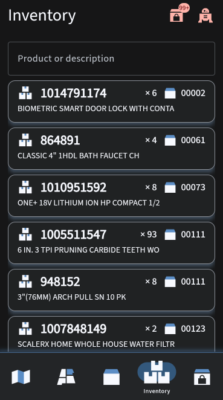

- The **Container Detail** screen shows each compartment's **products and quantities**, with compartments drawn to scale

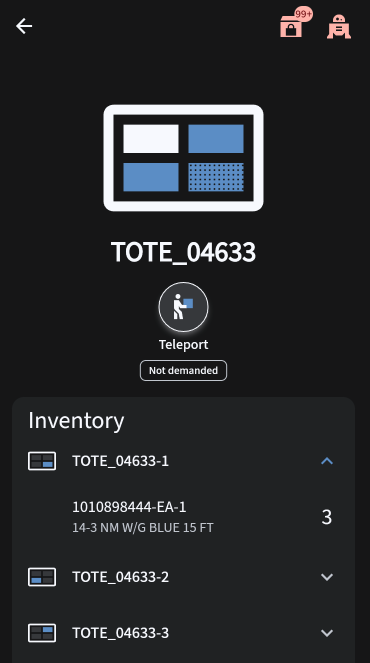

### 🚧 Safer with Safety Gates [#8517] [#8226] [#8818] [#8611] [#8612] [#8973] [#8977] [#8613] [#8614] [#8615] [#8616] [#8617] [#8559] [#8675] [#8560] [#8992]
SIMPLware now supports **requesting entry** into Safety Zones through Safety Gates!

- There are new **Safety Zone states** in Flo with new colors to indicate each state
	- **Unsafe**: RED
	- **Lock requested**: ORANGE
	- **Safe to enter**: GREEN
	- **Occupied**: PURPLE
- When you attempt to **lock** a Safety Zone with Flo, the zone will go into "Lock requested" (**orange**) state
  - While a zone is in this state, Ants outside of the zone will be **blocked from entering**, but Ants already inside the zone will continue to complete their active tasks until they **leave the zone**
  - Mantises will complete their **active tasks** then go to their **rest positions**
  - All robots in **Manual gear** will stay where they are
- Once all Ants have **left the zone** and all Mantises in the zone are **at rest**, the zone will change to "Safe to enter" (**green**) state, letting you know it is **safe to enter**
  - While the zone is safe to enter (green), robots in Manual gear can **still be moved manually** to the desired positions
- Upon **opening the gate** to enter the safety zone, the zone changes to "Occupied" (**purple**) state
  - In this state **no robots are ever allowed to move**
- When a Safety Zone has **no Safety Gate** associated with it, or the gate is **disabled**, locking the zone moves it instantly into the occupied state, preventing any movement
- Opening a Safety Gate **always** moves the zone into an **occupied state** and **halts all movement**, regardless of whether someone requested entry with Flo
- Safety Gates are mapped to their Safety Zones and imported from the **site layout**

### 🔐 Sign in to Flo with Microsoft [#6146] [#8750] [#8039] [#8348] [#8395] [#8398] [#8399] [#8981] [#8707] [#8708] [#8108] [#8758] [#8982] [#8830] [#8983] [#9027] [#9032] [#9058]
Flo now requires a SIMPL or Home Depot **Microsoft account** to sign in!

- Every user needs a **role** to sign in, and users without one are turned away
- Who can do what is managed by **SIMPL admins**, with no Entra changes needed
- Changing a robot's **gear** is now gated behind a permission [#9027]

## ⏫ Level-ups
### 🦾 Init E-stopped Mantises from Flo [#8767]
You can now **init an E-stopped Mantis** right from Flo!

### 🚦 Ant traffic keeps up at peak [#8713] [#8733] [#8734] [#8997] [#8018]
Ant traffic now **keeps up at peak volume**!

- Subgrid reservations now run in the new **Subgrid Reservation Service (SRS)**, so RES no longer bogs down as more Ants hit the floor
- Ants **roll the moment the path clears** after a gridlock or Safety Zone block [#8018]

### ⏱️ Urgent totes first [#8843] [#8678] [#8984] [#9046] [#9123] [#9024] [#9137] [#9139]
Ants now bring the **most urgent tote** to the workstation first!

- Totes that are **due now** jump to the front of the line, and storage ranks totes the same way MOM does [#8843] [#8678]
- Totes hit **top priority 30 to 60 minutes before they're due**, so there's time to finish them on time [#9046]
- Ants pick the most urgent tote waiting at the P&D [#8984] [#9123]

### 🧩 Every shelf back in play at tight workstations [#8458]
Workstations with tightly packed shelves can now use **every shelf** again! When an Ant reserves a shelf, its **neighbors are reserved too**, so Ants never squeeze in side by side and gridlock.

### 🧭 Teleported totes face the right way [#8482]
Teleport a tote and tell Flo which way it faces!

- When you **teleport** a tote that holds inventory, Flo shows its compartments and asks which way it should **face**
- SIMPLware remembers the direction you pick, so the right compartment is presented to the operator at the workstation afterwards

### 📥 Smarter putaway [#8264] [#8724] [#8273] [#8274] [#8453] [#8647] [#8658] [#8978] [#8120] [#8907]
Inbound totes now go to **the best spot**, not just the first open one!

- Ants pick the inbound **P&D** by weighing how full each Mantis is, how busy the workstation is, and how far away it is
- Mantises store inbound totes **along the way** to the next tote they need to fetch, cutting travel and setting up more dual cycles
- Totes coming in from a P&D are stored **close to that P&D**, instead of on any empty shelf [#8907]
- New aisles can be limited to **empty totes only** for putaway [#8724] [#8658] [#8978]

### 📊 Puls data you can count on [#8377] [#8266] [#8286]
Puls dashboards stay complete and up to date, even through outages!

- Puls dashboards **catch up on their own** after a database or network drop, instead of missing data [#8377]

### 🪵 Bot logs land when you need them [#8285] [#8287] [#8451] [#8855]
When a robot has a problem, its logs are there to dig into!

- Pulling a robot's logs for a task failure no longer holds up a full log pull for that robot, and vice versa [#8285]
- You can pull a **whole day's** logs for a robot in one go [#8287]
- When a robot **drops off the network**, its logs are pulled as soon as it's back [#8451]
- Log pulls that were waiting on a robot to reconnect are no longer lost when the bot log services restart [#8855]

### 🕐 Times that make sense [#9033]
Every time in Flo now shows in **12-hour format with AM/PM**!

### 🗃️ Storage tote loading has a new home [#8706]
**Storage tote loading** now lives in the overflow menu on Flo's **Containers** page

## 🪲 Bug fixes
- Ants no longer gridlock after replanning around a blocked path; a new RES setting lets them stop further back from the blocking Ant [#8908]
- SIMPLware no longer slows down or stops because Kafka's disks fill up or Redis runs out of memory: old robot messages are now cleaned up, and Kafka and Redis get more CPU and memory [#8961] [#8996] [#9056] [#9049]
- Totes are spread more evenly across workstations, and a workstation is no longer left waiting after a cancelled or failed transfer [#8537]
- Mantises are no longer sent to fetch a tote right after it's tagged ineligible, like when it's quarantined [#9075]
- Ant tasks no longer occasionally fail when the Ant is already sitting on its destination [#7456]
- The Flo Layout screen no longer has missing bays after a dropped connection [#8872]
- Deployments on large sites are faster now that the Layout Manager (LM) service no longer works out every travel distance at startup [#8425]
- SIMPLware no longer misses upstream data like workstation demand requests due to some intermediate network issues [#8657]
- During multi-aisle Tote Migration, Ants no longer wait under P&Ds after dropping off totes waiting for a new tote migration tote to pick up [#8868]
- At sites with more than one storage area, totes now always come from the storage area the work was assigned to [#8659]
- Ants will now charge during Tote Migration [#8895]
- When many Mantises are idle at once, like at shift start, they no longer wait as long to be given new work [#8871]
- Grafana log dashboards no longer get stuck showing no recent logs when one of the Loki log readers stops responding [#8963]

## 💽 Firmware updates
### All robots
- Wormhole: [`v2.2.1-20261109.2`](https://simplautomation.sharepoint.com/:u:/s/Engineering-SIMPLEngineering/IQA6Qg7pEnJtR5WSuPtuibYCARZdjJXHQi2Moqh3xcPHOIo?e=n2xwAn)

### Mantis 2.5
- NXP: [`Mantis-hwA4-v1.15.0-20261113.3`](https://simplautomation.sharepoint.com/:u:/s/Engineering-SIMPLEngineering/IQDbyixxD3g2RIAfeg3orxsxAfDEHXIQjHZ2Uocmh8EPyVA?e=9GsdZq)

### Mantis 2.6
- NXP: [`Mantis-hwC1-v1.15.0-20261113.3`](https://simplautomation.sharepoint.com/:u:/s/Engineering-SIMPLEngineering/IQAnUsqrVOtVRLP5TzD7e6OAAQNFnd7kgVkoFA6euZZmUDA?e=DU3a0b)

### Ant 3.0
- NXP: `0.20.0`

## 🧪 Development improvements
- Added a RES endpoint to update subgrids, carrying existing reservations over to the new subgrids [#6595]
- LVS is rebuilt on the SIMPL SDK and now sends Ant positions and Safety Zone reservations to Flo in pages [#5789]
- Automatic Ant replanning after a task or command failure can now be turned off with the new AMS `autoReplanOnFailure` setting (on by default) [#8916]
- Ant firmware now logs both command labels when it rejects a command for an invalid label, making those errors easier to trace [#7757]
- The RSS simulator now runs Ant commands at realistic speeds instead of a fixed one-second delay [#7955]
- MOM can now run as multiple copies at once to share the load [#8986] [#8987]
- Tote reservations are now managed only by CRS instead of being shared with MOM [#8134]
- Cleaned up the shared Flutter libraries behind Flo, removing workarounds and adding screenshot tests for its widgets [#8144]
- Robot Wormhole images now include full vim with color support, so color-coded logs are easy to read on the robot [#8814]
- `kpf` port-forwarding now uses non-standard local ports, so it no longer clashes with other apps on your laptop (for example, the Grafana login redirect) [#8962]
- Large Redis backups can now be restored without the copy timing out partway through [#9053]
- Flo now reads its layout name from site config like the other services, instead of having it built in per site, so one site can run different layouts across environments [#8976]
- Puls dashboards are now version-controlled and deployed through a repeatable process [#8359]
- Puls tables are now set up so site contributor roles can write to them without a manual permissions fix [#8877]
- Groundwork for **support tickets in Flo**: the code for the new POFS, SSS, RGZ (Zendesk) and RGADO (Azure DevOps) services and the Flo support screens is in place, ready for the launch in 3.3.0 [#6604] [#8145] [#8985]

## 🚧 Known issues
- Flo's Extract on the Robot Detail screen accepts a shelf location instead of a tote ID, and the robot then pulls out the shelf itself [#8866]
- Robots can sometimes stay offline after a short 4G drop until they're power cycled [#8313] [#8199] [#8411]
- Robots can sometimes sit on a task without moving until they're cleared, blocking other robots [#8147]
- Ants can sometimes form 4-way gridlocks [#8109]
- Mantises can sometimes gridlock with each other or with Ants [#8038] [#8040]
- After converting multi-compartment totes to 1-compartment, empty 1-compartment totes often aren't brought to decant workstations [#8667]
- After RVS starts, some Mantis robots can appear without bay assignments until statuses catch up [#8599]
- CTS sometimes takes a long time to update container tags [#6576]
- An Ant's battery level can jump up or down when it connects to or leaves a charger [#8383]
- A Mantis in Manual mode won't make a second move to a DM code in a row until it's switched to Auto and back [#8404]
- Orphaned totes can't be inducted from a Flo device, which shows "container with the same label already exists" [#8059]
- Flo doesn't show a Mantis anti-pinch rear fault [#8085]
- Workstations sometimes show as Off on the Flo Workstation and Workstation Detail screens when Tote Induction is enabled [#7779]
- Ants never show in "Moving" state [#7294]
- The on-screen keyboard cannot be used during Flo Tote Induction [#7905] [#7907]
- Pressing Escape on the Flo Tote Induction screen does not return to the Workstation Detail screen when the tote label field has focus [#8342]
- Flo shows "Invalid label format" when opening the bays of some workstations, like WST025 [#8067]
- On the Flo Containers screen, when lots of filters are selected, there is no room on smaller screens for the tote cards [#7851]
- Old robot logs aren't always cleaned up, so a robot's SD card can fill and stop saving new logs [#8995]

## 🚀 Deployment notes
- **New robot firmware?** YES
- **New Flo APK?** YES (v5.0.0)
- **New backend services:** SRS, SVS, USA
  - Deploy **SVS before CVS**, so Flo never loses tote tag info [#8730]
  - Deploy the sign-in services in this order: **Auth Kafka** (then Auth Kafka UI if wanted), **Auth Redis**, **USA**, then SIMPLware [#8398] [#8399] [#8981]
  - One-time per site before that: cert-manager, the `simpl-auth` namespace, the Auth Kafka certificate and login secrets, and a **multi-tenant** Flo Entra app with the site's redirect URIs and tenant admin consent [#8707]
- **Updated backend services:** ACAR, ADAS, AMS, AVS, CRS, CTB, CTS, CVS, DPS, GAS, IMS, IOCS, ITS, LM, LVS, MOM, POP, PUT, RAP, RAS, RES, RSS, RVS, SASG, SOS, TOM, WDS
  - Redeploy **Loki** with `hdeploy loki` so log dashboards recover on their own [#8963]
  - On its first start, **CVS** rebuilds its container views on its own; let it finish before using Flo [#8482]
- **Database migrations:** NO
- **Helm configuration changes:** YES
  - New **auth plane** in the `simpl-auth` namespace: **Auth Kafka** (TLS + SASL, with an optional locked-down Auth Kafka UI), **Auth Redis** (TLS + ACLs) and **USA**, each as its own Helm release [#8398] [#8399] [#8981]
  - **USA** is no longer part of the SIMPLware umbrella chart; it deploys on its own with `hdeploy usa`, and its blocks are removed from site configs [#8981]
  - Flo's Entra settings move to a **multi-tenant** app so users from every allowed tenant can sign in [#8707]
  - New **SVS** chart [#8728]
  - New **SRS** chart [#8733]
  - **SOS** Safety Gates are now set through Helm, with no gates configured by default, so sites with Safety Gates must add them to their config [#8977]
  - New **RES** setting for how far back an Ant stops from a blocking Ant after replanning [#8908]
  - Flo web must be served over **HTTPS on port 443** so Microsoft sign-in works, and it then connects to MQTT over secure WebSockets [#8108]
  - New **AMS** `autoReplanOnFailure` setting (on by default), and env vars to override **TOM**'s tote scoring weights [#8916] [#8843]
  - **LVS** now points at the writable RMS Redis instead of a read-only replica, or it won't start [#8973]
  - **Loki** read pods get a liveness probe, so a stuck one restarts on its own [#8963]
  - Redeploy **Kafka** and **Redis** (`hdeploy kafka`, `hdeploy redis`) to pick up the new Ant topic retention and the bigger CPU and memory settings [#8996] [#9056] [#9049]
  - New Flo setting for the **sign-in timeout** (default 30 seconds) [#8983]
  - THD sites still on the interim layout must set Flo's layout name (`env.layoutName`) to `THD_Pilot_Interim` before deploying, or Flo will show the full `THD_Pilot` layout [#8976]
- **Downtime requirements:** 6 hours full system downtime for infrastructure upgrades, SIMPLware deployment, and post-deployment validation

# v3.1.7 - Puls check

2026.10.28

## 🔥 Hotfix v3.1.7.2

2026.11.06

### 🪲 Bug fixes
- Robots again prioritize urgent workstation demand instead of treating every demand as having no deadline *(In Dev)* [#9005] [#9006]
- Ant and Mantis workflows no longer get stuck when RES hits a missing gridlock label [#9008]

### 🚀 Deployment notes
- **Updated backend services:** DPS, GAS, RES
- **Downtime requirements:** 30 minutes full system downtime

## 🔥 Hotfix v3.1.7.1

2026.11.02

### ⏫ Level-ups
#### 🐜 Ants reach Aisle 4 [#8905]
Ants can now **drive into Aisle 4**!

### 🪲 Bug fixes
- Ants no longer try to travel past a building column or into a P&D blocked by maintenance bays [#8894]

### 🚀 Deployment notes
- **Updated backend services:** LM
- **Downtime requirements:** None

## ✨ Shiny new stuff
### 📡 Bot log streaming [#8736] [#7912] [#7634] [#8265] [#8480] [#8519] [#8520] [#8521]
Robot logs can now **stream live to Puls**!

- Enable robot log streaming **per bot** using a suite of **MQTT control topics**
- Logs flow from each robot's **Wormhole board**, through the on-prem **POP service**, to **TimescaleDB** in Puls
- This will enable **deep robot behavior analytics** for real-time troubleshooting, and **future features** in our pipeline such as robot part lifecycle tracking and Periodic Maintenance scheduling

## ⏫ Level-ups
### 🦾 Mantis init with arms out [#8538]
Mantises can now be initialized **even with their arms out**! No more entering Mantis aisles to manually push them back in!

### 🚚 Migrate totes across aisles [#8723]
**Tote Migration** now supports moving totes **between aisles**!

- A tote's destination is no longer limited to what its **current Mantis** can reach
- Migrations still name a source and a destination, so **nothing changes** about how a move is requested
- No integration with Flo yet; Ants must be manually put in Tote Migration mode using the `robot-process.update` Kafka topic

### 📊 Puls 2.0 [#8419] [#7733] [#8330] [#8524] [#8531] [#8637] [#8810] [#8231] [#8422] [#8424]
Puls now runs on **TimescaleDB**!

- The Puls PUT service now reads and writes Puls data in **TimescaleDB** instead of CockroachDB
  - This enables better long-term **compression and archiving** features to support massive amounts of data!
- Puls SQL views are now **created automatically** for each tenant and site

## 🪲 Bug fixes
- Storage robots no longer pause between tasks and slow or stop tote delivery to workstations during heavy load [#8848]

## 💽 Firmware updates
### All robots
- Wormhole: [`v2.2.0-20261027.3`](https://simplautomation.sharepoint.com/:u:/s/Engineering-SIMPLEngineering/IQDnowcQ4qlUSrGMZB7sCfDjAYiKE6caRQRKNUJ36xV1VPU?e=OlFZHi)

### Mantis 2.5
- NXP: [`Mantis-hwA4-v1.14.0-2-g65c8d9e-20261027.1`](https://simplautomation.sharepoint.com/:u:/s/Engineering-SIMPLEngineering/IQA8ggDmbqoQSawhEyjdkh9OARhZNks_bpq9EQISBacbCws?e=JaXGSp)

### Mantis 2.6
- NXP: [`Mantis-hwC1-v1.14.0-2-g65c8d9e-20261027.1`](https://simplautomation.sharepoint.com/:u:/s/Engineering-SIMPLEngineering/IQA2qch30f7TT7818eaQ6w1ZAZ8F3znu9Ma--OwOdp_GsZY?e=Ebklr7)

## 🧪 Development improvements
- puls-admin Timescale commands no longer fail partway through when run over a kubectl port-forward [#8682]
- The puls-admin dev container now works on Home Depot laptops by trusting the corporate certificate authority [#8597]
- The NXP log analyzer tool can now start a local Superset to explore robot log data [#8498]

## 🚧 Known issues
- IOCS can stop receiving Pub/Sub messages with no clear error until it is restarted [#8657]
- Robots cannot be manually moved while inside locked Safety Zones [#8226]
- Ants can sometimes form 4-way gridlocks [#8109]
- During multi-aisle Tote Migration, Ants in Tote Migration mode with nothing to do sit idle at their last location instead of moving to rest, which can block a Mantis from finishing its migration [#8868]
- Pressing Escape on the Flo Tote Induction screen does not return to the Workstation Detail screen when the tote label field has focus [#8342]
- The on-screen keyboard cannot be used during Flo Tote Induction [#7905] [#7907]
- Workstations sometimes show as Off on the Flo Workstation and Workstation Detail screens when Tote Induction is enabled [#7779]
- After RVS starts, some Mantis robots can appear without bay assignments until statuses catch up [#8599]
- Ants never show in "Moving" state [#7294]
- CTS sometimes takes a long time to update container tags [#6576]
- The "No children" indication on the Flo Workstation Detail screen is confusing [#7402]
- On the Flo Containers screen, when lots of filters are selected, there is no room on smaller screens for the tote cards [#7851]

## 🚀 Deployment notes
- **New robot firmware?** YES
- **New Flo APK?** NO
- **New backend services:** NONE
- **Updated backend services:** CTB, MOM, POP, PUT
- **Database migrations:** New raw robot log tables in TimescaleDB for PUT [#8736]; new `source` column on every Puls table, with existing CockroachDB data copied over using puls-admin [#8524]
- **Helm configuration changes:** New bot-log EMQX broker config, the POP relay flag `pop.topics.bot-logs.enabled`, and PUT bot-log settings [#8660]; TimescaleDB TLS client certificates [#8643]
- **Downtime requirements:** All Mantises in Manual with no tasks for 15 minutes

# v3.1.6 - Shift happens

2026.10.21

## 🔥 Hotfix v3.1.6.1

2026.10.22

### 🪲 Bug fixes
- Overheight sensors at workstations are working again after the 3.1.6 update [#8813]

### 🚀 Deployment notes
- **Updated backend services:** DPS, GAS, IOCS, ITS
- **Downtime requirements:** None

## ✨ Shiny new stuff
Sorry, just the shiny old stuff for now 〰️

## ⏫ Level-ups
### 📏 Container offset updates (backend only) [#8753]
Tilted uprights? **Shift containers into place** without touching a tote!

- Container offsets can now be updated through a **new ITS ReST endpoint**
- Every container inside **moves right along with it**, so the whole stack stays lined up
- This is a **backend-only** change for now, with no Flo screen yet

### 📡 Simpler robot MQTT setup [#8455] [#8294] [#8439] [#8473] [#8352] [#8382]
Setting up robot MQTT is now **one page, no guesswork**!

- All MQTT settings now live in **one place on the robot's web page**, with direct mode as the default
- A new **Simple mode** hides internal details, with an **Expert mode** for advanced setups
- Saved settings are now **applied in the background**, so the page no longer hangs or drops when the network reconnects

## 🪲 Bug fixes
- Mantis 2.6 robots no longer go offline and need a reboot after a firmware issue during shuffle operations [#8653] [#8666]
- Robots no longer occasionally lose connection from unused WiFi services, which are now off by default [#8251] [#8460]
- Ants on the dance floor are no longer blocked by an Ant parked under a workstation, caused by leftover reservations that were never cleared [#8756] [#8757]
- Mantis robots no longer risk falling when a homing sequence is aborted [#8684]
- Robots no longer wait an extra 20 seconds to power off, including during emergency shutdowns [#8310]
- Overheight sensors at workstations are now matched to the right workstation, and every workstation now supports the overheight sensor bypass [#8794] [#8800]
- Tasks no longer hang because Mantis command updates were dropped by an overloaded message broker [#8630]
- Ants turned away from a full or no-longer-needed workstation no longer get stuck instead of leaving [#8772]
- Ants A-151 and A-152 can once again plan paths out of their rest positions [#8737]
- Locations are no longer tagged INACCESSIBLE when a task fails for reasons unrelated to that location [#8760]
- Tote compartment changes now happen in a single step, so a half-finished reconfiguration can't be left behind [#8752]
- Mantis and Ant LEDs no longer get stuck on one color pattern [#8598]
- Robot LED presets and settings no longer occasionally fail to sync to the LED controller [#8309]
- Downloading large logs from the robot's web page no longer fails partway through [#8474]
- Remote terminal access to robots no longer occasionally fails to start after a reboot [#8267]

## 💽 Firmware updates
### All robots
- Wormhole: [`v2.1.9-20261016.1`](https://simplautomation.sharepoint.com/:u:/s/Engineering-SIMPLEngineering/IQCsah7eAA1_TJuip_fV3ociAYGOxgDeetk54RlO68Jd8xc?e=8KFhVI)

### Mantis 2.5
- NXP: [`Mantis-hwA4-v1.14.0-1-gd45a1fe-20261016.1`](https://simplautomation.sharepoint.com/:u:/s/Engineering-SIMPLEngineering/IQCioQ3x_gI3RJoulIvSy2j0AbxoGIZZ92Z94Wu_nEhc_X8?e=aikz9y)

### Mantis 2.6
- NXP: [`Mantis-hwC1-v1.14.0-1-gd45a1fe-20261016.1`](https://simplautomation.sharepoint.com/:u:/s/Engineering-SIMPLEngineering/IQBnSLOcVSNvR5fiFtpMOU9xAdcYvltDuEwouRpVRCEkqMQ?e=ksJuej)

## 🧪 Development improvements
- Robots now shut down cleanly when they detect an incoming power loss, so logs and files are no longer cut off mid-write [#8427]
- Extended the Ant layout to the newly commissioned aisle 3 in Locust Grove [#8768]
- Robots now detect their CAN bus speed automatically instead of relying on a fixed setting per robot type [#8726]
- The network link between the Wormhole and the robot's main controller now negotiates a stable, fixed speed [#8325]
- Moved the LM ReST layer from Flask to FastAPI for more reliable messaging [#8725] [#8685]
- Motor controller firmware upgrades no longer time out partway through [#8751]
- WiFi setting changes on the robot's web page no longer fail silently after being saved [#8528]
- Robot crash logs are now kept after an unexpected reboot, so crashes can be debugged without a live serial connection [#8128]
- Robots no longer drop their first startup log messages, so version and reset-reason logs are always captured [#8099]
- CAN logging now starts reliably at boot, without waiting for the robot's clock to sync [#8475] [#8254]
- Robots now log WiFi roaming between access points (when WiFi is enabled), including how long each handoff takes [#8227]
- Robots can now capture 4G network traffic to help diagnose cellular connection issues [#8304]
- Robots now save their LED controller logs to the SD card for easier LED troubleshooting [#8326]
- The SD card can now be formatted from the System Tools panel on the robot's web page, with no command-line access needed [#8303]
- Robots now share network time with devices on their local network and name themselves after the robot for easier discovery [#8327]
- Robot network hostnames now update when the robot's label changes [#8592]
- Robot WiFi network interfaces have been renamed so they no longer clash with the 4G interface [#8402]

## 🚧 Known issues
- IOCS can stop receiving Pub/Sub messages with no clear error until it is restarted [#8657]
- Robots cannot be manually moved while inside locked Safety Zones [#8226]
- Ants can sometimes form 4-way gridlocks [#8109]
- Pressing Escape on the Flo Tote Induction screen does not return to the Workstation Detail screen when the tote label field has focus [#8342]
- The on-screen keyboard cannot be used during Flo Tote Induction [#7905] [#7907]
- Workstations sometimes show as Off on the Flo Workstation and Workstation Detail screens when Tote Induction is enabled [#7779]
- After RVS starts, some Mantis robots can appear without bay assignments until statuses catch up [#8599]
- Ants never show in "Moving" state [#7294]
- CTS sometimes takes a long time to update container tags [#6576]
- The "No children" indication on the Flo Workstation Detail screen is confusing [#7402]
- On the Flo Containers screen, when lots of filters are selected, there is no room on smaller screens for the tote cards [#7851]

## 🚀 Deployment notes
- **New robot firmware?** YES
- **New Flo APK?** NO
- **New backend services:** NONE
- **Updated backend services:** AMS, DPS, GAS, IMS, ITS, LM, MOM, RCS
- **Database migrations:** NONE
- **Helm configuration changes:** NONE
- **Downtime requirements:** 45 minutes full system downtime

# v3.1.5 - Mind the gap

2026.10.02

## ✨ Shiny new stuff
Sorry, just the shiny old stuff for now 〰️

## ⏫ Level-ups
### 📐 Safer Mantis tote gap detection [#8464]
Mantis now checks that the **tote gap is wide enough** before extracting — if not, it uses a **rib grab** instead of risking a push or misalign.

- RMS now passes a configurable **gap size** for gap search (firmware no longer stuck on the default) [#8649]

## 🪲 Bug fixes
Nothing to see here 🙈

## 💽 Firmware updates
### Mantis 2.6
- NXP: `v1.13.0-8-g9886a82`

### Mantis 2.5
- NXP: `v1.13.0-8-g9886a82`

## 🧪 Development improvements
- IMS can now create Mantis containers (Kafka mapper for Mantis container type was missing) [#8641]

## 🚧 Known issues
- IOCS can stop receiving Pub/Sub messages with no clear error until it is restarted [#8657]
- Robots cannot be manually moved while inside locked Safety Zones [#8226]
- Ants can sometimes form 4-way gridlocks [#8109]
- Pressing Escape on the Flo Tote Induction screen does not return to the Workstation Detail screen when the tote label field has focus [#8342]
- The on-screen keyboard cannot be used during Flo Tote Induction [#7905] [#7907]
- Workstations sometimes show as Off on the Flo Workstation and Workstation Detail screens when Tote Induction is enabled [#7779]
- After RVS starts, some Mantis robots can appear without bay assignments until statuses catch up [#8599]
- Ants never show in "Moving" state [#7294]
- CTS sometimes takes a long time to update container tags [#6576]
- The "No children" indication on the Flo Workstation Detail screen is confusing [#7402]
- On the Flo Containers screen, when lots of filters are selected, there is no room on smaller screens for the tote cards [#7851]

## 🚀 Deployment notes
- **New robot firmware?** YES
- **New Flo APK?** NO
- **New backend services** NONE
- **Updated backend services** IMS, RCS, RMS
- **Database migrations** NONE
- **Helm configuration changes** NONE
- **Downtime requirements** 30 minutes full system downtime

# v3.1.4 - Bits and bots

2026.09.24

## ✨ Shiny new stuff
Sorry, just the shiny old stuff for now 〰️

## ⏫ Level-ups
Steady as she goes 🚢

## 🪲 Bug fixes
- Mantis extracts fail less often when the tote is sitting a bit too close to the Mantis [#8446]
- Ants rejected at a workstation entrance are no longer sometimes sent straight back to that same workstation [#8454]
- Robots no longer sometimes get stuck with a stale state reservation after being cleared [#8459]
- After an Ant finishes a move, the path it was using is now reliably cleared so other Ants aren’t blocked behind it [#8465]
- Reconfiguring tote compartments no longer leaves the tote as "Deleted" in Flo [#8449] [#8468]
- After an Ant drops a tote at a P&D and skips the next pickup there, it no longer keeps holding the P&D so other Ants shove totes off it [#8467] [#8491]
- The Flo Workstation and Workstation Detail screens no longer show that a workstation is requesting something when nothing is actually being requested [#8495]
- `tote.moved` Kafka messages no longer project the wrong orientation for orphaned totes [#8497]
- Missing tote gap and overheight sensors have been added to the Flo Mantis Detail screen [#8483] [#8461]
- The accessible switch on the Flo Tunnel Detail screen now takes effect on the first press [#8463]

## 💽 Firmware updates
No firmware updates required! ✅

## 🧪 Development improvements
NONE

## 🚧 Known issues
- Robots cannot be manually moved while inside locked Safety Zones [#8226]
- Workstations sometimes show as Off in Flo when Tote Induction is enabled [#7779]
- Ants can sometimes form 4-way gridlocks [#8109]
- Ants never show in "Moving" state [#7294]
- CTS sometimes takes a long time to update container tags [#6576]
- The on-screen keyboard cannot be used during Flo Tote Induction [#7905] [#7907]
- The "No children" indication on the Flo Workstation Detail screen is confusing [#7402]
- On the Flo Containers screen, when lots of filters are selected, there is no room on smaller screens for the tote cards [#7851]
- Robots drop some logs at startup [#8099]
- Pressing Escape on the Flo Tote Induction screen does not return to the Workstation Detail screen when the tote label field has focus [#8342]

## 🚀 Deployment notes
- **New robot firmware?** NO
- **New Flo APK?** v4.6.21
- **New backend services** NONE
- **Updated backend services** AVS, GAS, IMS, MOM, RES, RMS
- **Database migrations** NONE
- **Helm configuration changes** Flo `CT_CONTAINER_TAG_UPDATE` updated for [#8463] (accessible switch timeout) — auto-applied at deploy time
- **Downtime requirements** 30 minutes full system downtime

# v3.1.3 - Watch your weight!

2026.09.17

## ✨ Shiny new stuff
Sorry, just the shiny old stuff for now 〰️

## ⏫ Level-ups
### ⚖️ Tote weight capacity [#7069] [#8434]
Tote selection now accounts for **weight**, not just empty compartments!

- When choosing a tote for empty compartments, we now also check that it has enough **remaining weight capacity** for what will be placed in it [#7069]
- Tote weights are **seeded at startup** so that check starts from an accurate picture [#8434]

### 🏷️ Accessible reason capture [#8407]
When you **enable accessibility** on a tunnel in Flo, you can now capture why!

- You’re prompted to choose a **resolution reason**
- That reason is forwarded to **Puls** for analysis

### 🚚 Tote migration by container tag [#8311] [#8441]
Tote migration can now filter by **container tag**!

- You can **exclude totes by container tag** when migrating
- Clear a bay of totes that still have inventory (for example **maintenance bays**, or inventory that landed mid-migration) with less manual checking

## 🪲 Bug fixes
- Ants no longer take a P&D pickup path that WIP would block, so they can still meet robot-type demand instead of getting stuck [#8194]
- DPS shelves are accessible again on the DPS Workstation Bay Detail screen [#8385]
- Ants no longer spin at the charger when tasked with an unsupported orientation — path planning fails that case instead [#8394]
- Flo now correctly supports teleporting to DPS workstation locations [#8405]
- Ants no longer end up with the wrong orientation after being manually moved with Flo [#8406]
- Totes now maintain their orientation after being teleported with Flo [#8440]
- Quarantined compartments no longer show up at workstations when they aren't supposed to [#8448]

## 💽 Firmware updates
No firmware updates required! ✅

## 🧪 Development improvements

## 🚧 Known issues
- Robots cannot be manually moved while inside locked Safety Zones [#8226]
- Workstations sometimes show as Off in Flo when Tote Induction is enabled [#7779]
- Ants can sometimes form 4-way gridlocks [#8109]
- Ants never show in "Moving" state [#7294]
- CTS sometimes takes a long time to update container tags [#6576]
- The on-screen keyboard cannot be used during Flo Tote Induction [#7905] [#7907]
- The "No children" indication on the Flo Workstation Detail screen is confusing [#7402]
- On the Flo Containers screen, when lots of filters are selected, there is no room on smaller screens for the tote cards [#7851]
- Robots drop some logs at startup [#8099]
- Orphaned totes can end up with the wrong orientation after a move [#8497]
- Pressing Escape on the Flo Tote Induction screen does not return to the Workstation Detail screen when the tote label field has focus [#8342]
## 🚀 Deployment notes
- **New robot firmware?** NO
- **New Flo APK?** v4.6.18
- **New backend services** NONE
- **Updated backend services** ADAS, CTB, CVS, GAS, IMS, LM, MOM, TOM
- **Database migrations** NONE
- **Downtime requirements** 30 minutes full system downtime

# v3.1.2 - Pick up the pace!

2026.09.10

## ✨ Shiny new stuff
Sorry, just the shiny old stuff for now 〰️

## ⏫ Level-ups
### 💪 Flo enhancements
Flo is now more **stable**, **accurate**, and **performant**!

- **Startup** is a lot faster! [#8252]
- Flo has been upgraded to use **MQTT 5** [#8324]
  - This allows Flo to take advantage of **EMQX broker queueing** so it no longer misses any push updates during brief disconnects
  - This resolves several issues where Flo sometimes presented **outdated information** throughout the app, including:
    - Container enabled / disabled state
    - Safety Zone lock states [#8328]
    - Ant tote-onboard state during tote induction [#8189]
- Updates to the Areas and Area Detail screens are **faster** [#7978]
- You are now only allowed to have a **single Flo browser tab** open at a time. This ensures Flo doesn't use too many resources on your device, degrading performance [#8276]
- Tapping the **robot alert icon** now removes any previous filters you had applied [#7828]
- **Task creation failures** now show separately from task failures [#8214]
- Additional protections have been added to make sure Flo never shows Ants with totes onboard that aren't really there during Tote Induction [#8190] [#8189]

### 🦺 Keep an eye on locked Safety Zones [#8239]
Locked Safety Zones are now **always visible** in the Flo Layout screen.

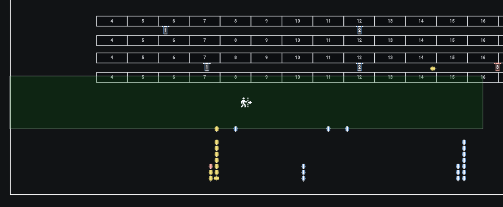

### 📦 Flo teleport enhancements [#8289] [#8277]
Flo now supports teleporting totes to **Storage P&Ds** and **DPS Workstation shelves**.

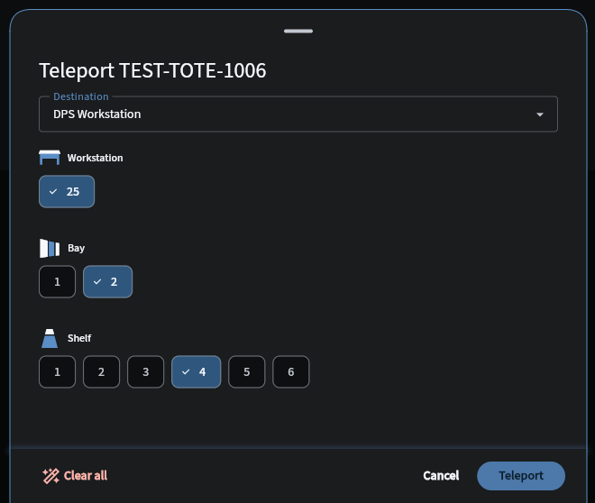

### 🚦 Ant failure detours [#8316]
Ants will now take **detours** around other Ants that have **failed tasks**.

## 🪲 Bug fixes
- Flo no longer sometimes shows that workstations are "Requesting" something when they are not [#7036]
- Flo no longer allows Ants to carry more than one tote in some cases during Tote Induction [#8057] [#8062]
- Flo no longer sometimes shows incoming transfers on the Areas and Area Detail screens when none exist [#8343]
- Flo no longer sometimes shows robots as offline that are not actually offline due to temporary Redis outages [#8363]
- Some Flo icons are no longer off-center on smaller screens [#8263]
- New Ants can now be added to the system [#8381]
- Mantises now correctly select totes for delivery to workstations after bay purview changes [#8299] [#8366]
- Ants no longer get stuck under P&Ds after depositing due to incorrect container reservations [#8125]
- Ants don't wait as long under P&Ds after dropping off totes with inventory [#8191] [#7228]
- Ants no longer travel to invalid locations due to incorrect destination shortening [#8261] [#8280]
- Ants no longer get stuck entering workstations due to various issues [#7824] [#8290] [#8288]
- Ants no longer fail tasks in some Exit task replanning cases [#8293]
- Workstations no longer receive extra empty containers at startup in some cases [#8187] [#8317]
- Ants no longer get stuck after being cleared while exiting DPS workstations [#8193]
- Tote orientations are now correctly emitted in `tote.moved` Kafka messages [#8295]

## 💽 Firmware updates
No firmware updates required! ✅

## 🧪 Development improvements
- Performance improvements for GAS and DPS container move processing [#8031]
- Workstations are now configured correctly in QA environments [#7658]
- MOM now publishes specific failure reasons when tagging a tunnel as inaccessible. This will be used later in Flo [#8156]
- `move.container` Kafka API now accepts orientations to rotate containers upon move. This will be used later for Flo teleportation [#8292]
- Flo now correctly shows bay assignments in fresh QA environments [#8336]
- A new environment variable has been added to IOCS to allow disabling of incoming messages for testing purposes [#8279]
- Fixed some gridlock issues in QA caused by missing command shortening [#8345]

## 🚧 Known issues
- Robots cannot be manually moved while inside locked Safety Zones [#8226]
- Workstations sometimes show as Off in Flo when Tote Induction is enabled [#7779]
- Ants can sometimes form 4-way gridlocks [#8109]
- Ants never show in "Moving" state [#7294]
- CTS sometimes takes a long time to update container tags [#6576]
- The on-screen keyboard cannot be used during Flo Tote Induction [#7907]
- The "No children" indication on the Flo Workstation Detail screen is confusing [#7402]
- On the Flo Containers screen, when lots of filters are selected, there is no room on smaller screens for the tote cards [#7851]
- Robots drop some logs at startup [#8099]

## 🚀 Deployment notes
- **New robot firmware?** NO
- **New Flo APK?** v4.6.14
- **New backend services** NONE
- **Updated backend services** ADAS, AMS, AVS, CVS, DPS, GAS, IMS, IOCS, LM, MOM, POP, RES, RVS, TOM
- **Database migrations**
  - AVS: `ui-area-legacy-cleanup-v3`
    - Cleans `ui:area:<area-label>` keys and replaces them with sub-keys like `ui:area:tags:<area-label>`
- **Downtime requirements** 1 hour of full system downtime

# v3.1.1 - Safer Zones + Faster TOM

2026.08.28

## ✨ Shiny new stuff
Sorry, just the shiny old stuff for now 〰️

## ⏫ Level-ups
### 🦺 Safety Zones are even better [#7986] [#7555] [#8122] [#8210] [#7661]
Safety Zones are now created directly from the building's **CAD file**!

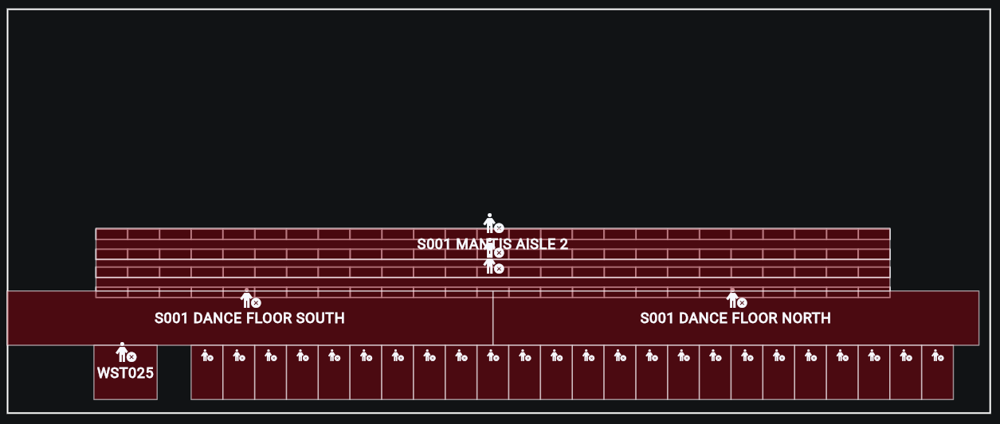

- After a **new layout file** is loaded into the Layout Manager (LM) service, Safety Zones are **automatically re-loaded** into the system and **reflected in Flo**
- Safety Zone locks are now **near-instantly blocking**, causing all robots to **pause** when inside locked Safety Zones and **instantly blocking** any other robots from entering
- Several minor Flo enhancements have been made to make Safety Zones easier to understand and interact with

### 🏎️ Mantis tote selection enhancements [#8215] [#8204] [#8162] [#8127] [#8140]
TOM tote selection planning is now **faster** and **more accurate**!

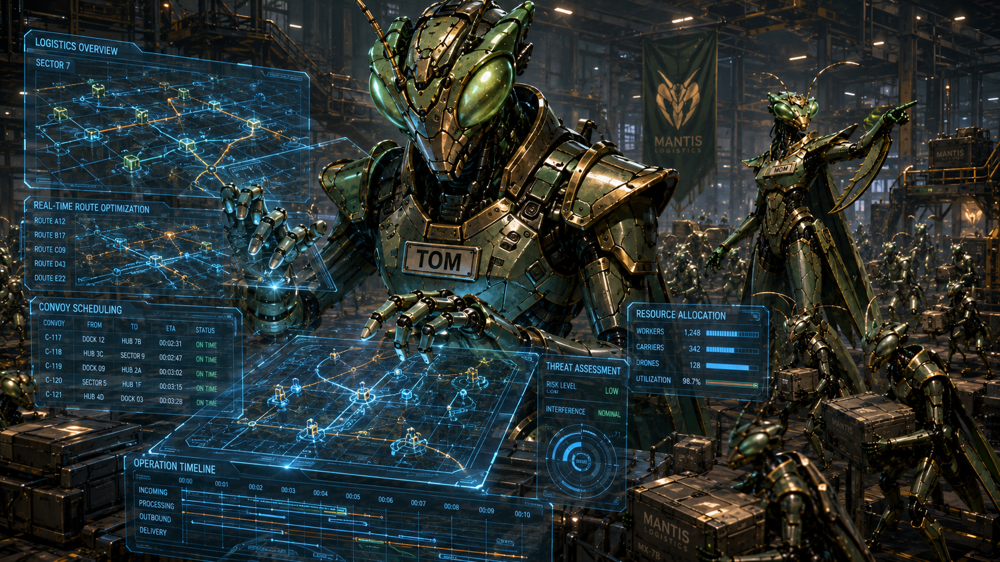

- TOM now has an **optimized distance calculation**, calculating **accurate tote distances** from Mantises' current positions
- TOM **tote scoring** is significantly faster, leading to **more accurate** selection of totes for Mantis extracts
- MOM now considers **workstation WIP** when selecting totes for Mantis extracts
- TOM resource utilization has also been significantly reduced

## 🪲 Bug fixes
- The THD Pilot layout has some enhancements for Ant detours as well as Ant nodes removed for maintenance bays [#8209]
- Robots no longer fail tasks with "coordY" errors [#8133]
- Ants no longer fail tasks with "Error in command success handling" errors [#8161] [#8025]
- Ants no longer fail Exit tasks with "Replanning failed" errors [#8222] [#7438]
- Ants no longer fail DPS Exit tasks with pathing errors [#8201]
- Mantises no longer fail tasks with failure reasons equal to the name of the Mantis [#8198] [#8200]
- Mantises no longer sometimes fail tasks when blocked by locked Safety Zones [#8216]
- Mantises no longer fail tasks with "Expected state not match" errors when encountering end-of-arm sensor issues during a shuffle deposit [#8217]
- Mantis homing code capture is working again [#8153]
- Fixed some nav node reservation issues [#8207]
- Ants no longer slowly "creep" in some cases [#8256]
- Excess totes no longer arrive at workstations due to fast Mantis planning [#8188]
- Safety Zone view toggling in Flo no longer resets your visibility settings [#7661]
- Flo now shows Ant task creation failures [#8027]
- Flo now shows accurate "Requesting" values on the Areas and Area Detail screens [#6994] [#7036] [#8158]
- On the Flo Areas screens, incoming transfers are reflected faster when first turning on a workstation [#7836]
- Flo is more performant when loading containers for the first time after an update [#6768]
- Robots now show offline in Flo if your device does not receive any updates from SIMPLware within a certain amount of time [#7480]
- Container enablement is now respected for DPS locations [#8095]
- DPS stations no longer receive too many empty Ants, and clearing bots at DPS stations no longer causes Ant tasking problems [#8016]
- Ants no longer miss some startup NXP logs [#8105]

## 💽 Firmware updates
### Ant 3.0
- NXP: `Ant-hwE1-v0.16.0-3-g0bdd5eb`
- Wormhole: `v2.1.8-20260826`

## 🧪 Development improvements
- Container export now supports partial export via optional list of container labels [#8218]
- Robot-info topics are now supported by IOCS [#8011]
- Robots come back online in Flo faster after certain SIMPLware upgrades [#8020]
- Better planning time logging in TOM [#8197]
- MOM now uses planning ID in logs for easier diagnosis of issues [#8131]
- AMS has new Ant task status: REPLANNED [#8212]
- Gathering new analytics data into the Puls environment [#8182] [#8203] [#8260]
- ITS Redis setup issues resolved [#8185]
- Ant firmware has some stricter version control [#8105]

## 🚧 Known issues
- Flo sometimes inaccurately reports that an Ant has a tote onboard after it presents during Tote Induction [#8190]
- Flo does not make a visual distinction between task failures and task creation failures [#8214]
- Totes sometimes get stuck in P&D locations [#8125]
- Robots cannot be manually moved while inside locked Safety Zones [#8226]
- Clicking the robot alert button in Flo does not remove previously added filters, often hiding robots that have problems until the filters are manually removed [#7828]
- Flo sometimes does not accurately reflect the state of a robot for a short time [#8021]
- Flo allows Ants to have more than one tote on them during tote induction in some cases [#8062]
- Ants do not detour around Mantises that are in Manual [#7288]
- Workstations sometimes show as Off in Flo when Tote Induction is enabled [#7779]
- IMS has some performance issues when tagging containers [#7228] [#6576]

## 🚀 Deployment notes
- **New robot firmware?** YES
- **New Flo APK?** v4.6.6
- **New backend services** NONE
- **Updated backend services** AVS, AMS, CTB, DPS, IMS, IOCS, ITS, LM, LVS, MOM, POP, RES, RMS, RVS, TOM
- **Database migrations** NONE
- **Downtime requirements** 1 hour of full system downtime

# v3.1.0 - Meet TOM and MOM

2026.08.16

## ✨ Shiny new stuff
### 🏎️ Mantises orchestration just got a lot faster [#7077]
Introducing **TOM** and **MOM**!

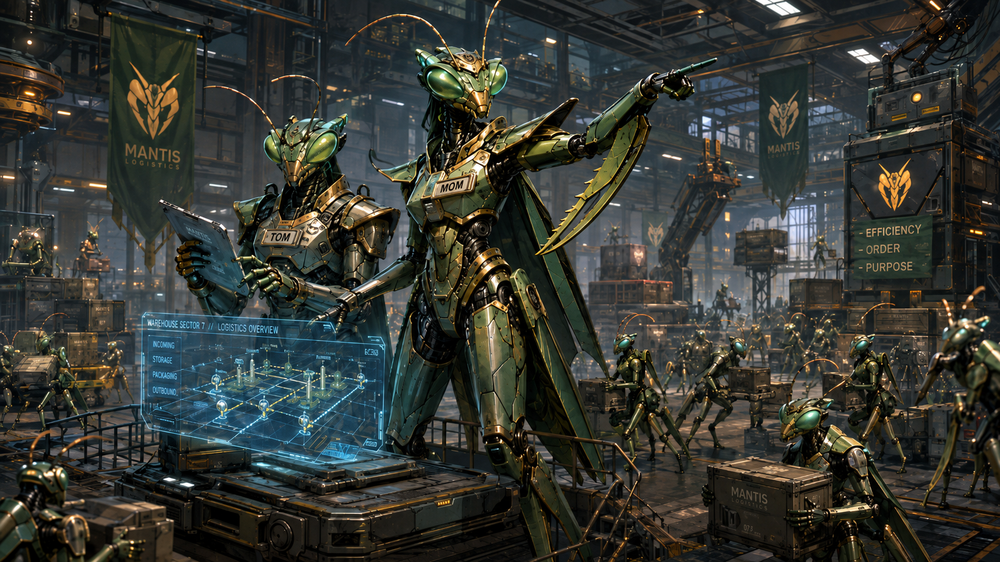

- The **time Mantises have to wait** to be told what to do next has been dramatically reduced
- The new **Tote Optimization for Mantis (TOM)** service continually **ranks totes** for Mantis extraction as conditions on the ground change
- The new **Mantis Orchestration Mothership (MOM)** service takes advantage of **TOM's pre-planning**, and is able to **quickly** tell Mantises what to do when they are **empty-handed**
- MOM also orchestrates the **Ants** within the **Storage area**, but there are no major improvements here; this is a 1-for-1 replacement of functionality **previously** handled by **SASG**
  - That's right, **SASG is no more**; TOM and MOM are the new Storage area commanders.

## ⏫ Level-ups
Steady as she goes 🚢

## 🪲 Bug fixes
- Workstations demanding totes that have been deleted will still receive Ants to fulfill other eligible demand at the workstation [#8086] [#8088]
- Lots of Ant gridlock fixes [#7673]
- Ants no longer fail tasks due to action reservation creation failures in RES [#8047]
- Ants no longer gridlock due to overlapping reservations caused by small command reservation buffers [#8032]
  - This buffer is now configurable in RES
- Robots should no longer be blocked by other robots that are not nearby due to hanging reservations caused by some SIMPLware upgrades as well as command validation request timeouts [#7713] [#7773] [#7762] [#8048]
- Ants no longer deliver totes to Mantises that don't have any more space available [#8009] [#8015]
- Ants no longer get stuck at workstations after being dismissed due to a class cast exception in the SIMPL SDK [#8113]
- Ant Exit tasks should no longer fail with "Error in command rejection handling" [#8064]
- Mantises no longer try to extract totes in other aisles due to bad indexing of compartments, causing large blockages of other robots [#8034] [#8035]
- Ants no longer fail to enter workstations due to lack of container ancestor check retries [#7824] [#8041]
- Mantis extract tasks should no longer fail with "Expected State: armPosition" during re-grab retries [#8076]
- Ants no longer consistently overshoot their target commanded positions, resolving several issues [#7439] [#7382] [#7461] [#7713] [#7820] [#7842]
- Robots no longer show as offline in Flo about once every 10 minutes [#7978]
- Containers on the Flo Containers screen are now sorted by number correctly [#7362]
- Kafka brokers are no longer being killed due to excessive memory consumption, resolving several issues [#7974] [#7975] [#7977] [#7976] [#8019]
- Compartment containers are no longer incorrectly cast to P&D Shelf containers in some edge cases in the SIMPL SDK, causing several issues [#8123]

## 💽 Firmware updates
No firmware updates required! ✅

## 🧪 Development improvements
- Various data improvements in the Puls ecosystem [#7890] [#6641]
- Auto-clear can now be configured through various Kafka topics [#8063]
- Bot log ingestion pre-work [#7546]
- Additional Puls analytics data ingestion [#8026] [#8066] [#8044] [#8110]
- Pre-work for future improvements to traffic control, detour logic, robot task replanning and integration with safety zone [#7431]
- Pre-work for future safety zone loading from CAD import [#7986] [#7555]
- Tons of pre-work for future authentication and support ticket features in Flo and Puls [#6531] [#6532] [#6569] [#6571] [#6574] [#6575] [#6577] [#6593] [#6594] [#6598] [#6668] [#6692] [#6716] [#6722] [#6723] [#6724] [#6811] [#6990] [#7652] [#6533] [#7917] [#8104] [#7891]
- Pre-work for being able to paint workstations in the Flo Layout screen [#7298]
- IOCS messaging enhancements [#7996] [#8079]
- Some SIMPL SDK exceptions are no longer swallowed [#7823] [#7841]
- WDS now rejects `workstation-demand.upsert` messages if the two `destinationWorkstationLabel` fields do not match [#7253]
- GAS now publishes `ant.dismiss.rejected` Kafka messages when consuming `ant.dismiss` messages for unknown workstations
- Updated `workstation-demand.upsert` validation logic for DPS stations [#7278]
- Waltham layout bug fixes [#6763]

## 🚧 Known issues
- On the Flo Areas screens, incoming transfers are not visible until the first Ant arrives at the workstation [#7836]
- Workstations sometimes show as Off in Flo when Tote Induction is enabled [#7779]

## 🚀 Deployment notes
- **New robot firmware?** NO
- **New Flo APK?** v4.6.1
- **New backend services** MOM, TOM
- **Updated backend services** ACAR, AMS, CTB, CTS, GAS, IOCS, LM, POP, PUT, RAP, RES, RMS, SASG, WDS
- **Database migrations** NONE
- **Downtime requirements** 1 hour of full system downtime

# v3.0.5 - Ants on demand

2026.08.05

## ✨ Shiny new stuff
Sorry, just the shiny old stuff for now 〰️

## ⏫ Level-ups
### ⚖️ Tote Induction Ant request control in Flo [#7734]
You can now **directly control** the number of Ants you would like to request at each workstation for Tote Induction in Flo!

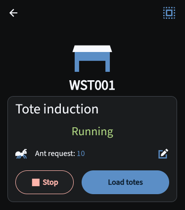

- The **Tote Induction card** has gotten a bit of a **makeover** that makes controlling Tote Induction more intuitive
- Tap on the **Ant request tile** to set the number of Ants you would like to request for the workstation
- The Ant request setting can be updated **before** or **during** Tote Induction

### 🗺️ Flo Layout optimizations [#7821]
The **Layout** in Flo has a couple of new improvements!

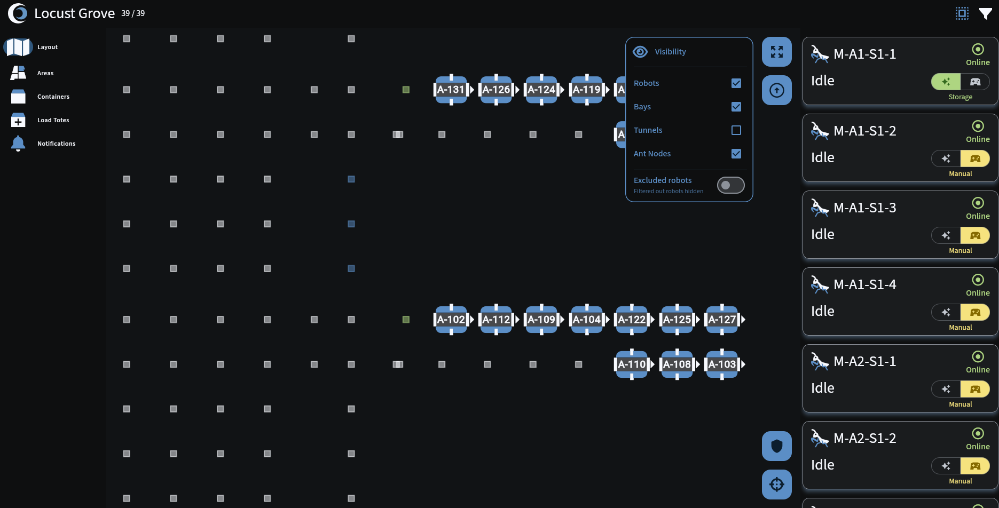

- When **targeting** a robot, Flo no longer **zooms** in really close to the robot (keeps your **current zoom** level)
- You can now see **Ant nodes** from **farther away**, and Ant node visibility is now **dynamically adjusted** based on the size of your screen
- **Tunnel visibility** is **disabled** by default to help with performance

## 🪲 Bug fixes
- Robots should no longer get stuck in gridlocks due to overlapping reservations [#7713] [#7927]
- Ants should no longer fail tasks with "Future state not match" errors when trying to move just after coming to a stop [#7904]
- Ants should no longer overshoot their target commanded position, causing overlapping reservation gridlocks and "Diff drive" task failures [#7842] [#7439] [#7382] [#7713] [#7461] [#7820]
- Ants should no longer need to be manually rebooted due to infinite reconnect attempts [#7737] [#7760]
- When a Mantis detects product protruding above the top of a tote after extract, it now puts the tote back on the shelf it extracted it from [#7998]
- Totes tagged for pull quarantine will no longer be delivered to Workstations when the product in them is requested by the Workstation [#7936]
- Ant should now be able to exit DPS workstations after being cleared [#8003]
- Mantis Physical Audit should now work correctly [#7928] [#7929]
- Mantis P&D offset collection should now work correctly [#7922] [#7937]
- An additional confirmation dialog has been added to Flo when trying to shift an Ant into Manual while it is presenting at a workstation [#7933]
- During Flo Tote Induction, when an existing orphan tote is selected, the compartment selection now clears on all devices monitoring that workstation [#7945] [#7946] [#7862]
- Totes with inventory can no longer be deleted unless the inventory is first deleted [#7919] [#7920] [#7865] [#7902]
- Some dialog verbiage cleanup in Flo [#7969]
- Some capitalization fixes in Flo [#7863] [#7954]

## 💽 Firmware updates
### Ant 3.0
- NXP: `Ant-hwE1-v0.14.0-5-gd1a50c5`

## 🧪 Development improvements
- New Inventory Export API can be used to export inventory independent of containers [#7856]
- Additional Puls analytics data being collected for Ant task failures and updates [#7839] [#7971]
- SOS has been updated to the latest SIMPL SDK version [#7914] [#7921]
- Orphaning totes now produces `container.moved.RCS` and `tote.moved` Kafka messages [#7918]
- Ants now publish to MQTT topic `robot/connection/status` whenever they successfully connect to EMQX, and EMQX itself publishes to that same topic whenever an Ant disconnects from EMQX [#6964]
- ADAS and SASG have been updated to consume the new Area Demand Update Kafka topic [#7819]
- Several services have been updated to eliminate duplicate unused concurrent Kafka connections [#7974] [#7975] [#7961]
- `RedisMigrator` is now available in the SIMPL SDK to make writing and deploying data migrations easier [#6697]
  - This was deployed in an earlier release but missed tracking on release notes

## 🚧 Known issues
- All robots show as offline in Flo about once every 10 minutes [#7978]
- On the Flo Area screens, incoming transfers are not visible until the first Ant arrives at the workstation [#7836]
- Workstations sometimes show as Off in Flo when Tote Induction is enabled [#7779]

## 🚀 Deployment notes
- **New robot firmware?** YES
- **New Flo APK?** v4.5.23
- **New backend services** NONE
- **Updated backend services** ACAR, ADAS, AVS, CTB, CTS, CVS, DPS, GAS, IMS, IOCS, ITS, POP, PUT, RAS, RES, RQS, RVS, SASG, SOS, WDS
- **Database migrations** NONE
- **Downtime requirements** 30 minutes of full system downtime

# v3.0.4 - Bug bash + Better Tote Induction

2026.07.25

## ✨ Shiny new stuff
Sorry, just the shiny old stuff for now 〰️

## ⏫ Level-ups
### ➕ Improved tote induction workflow [#7727]
Flo has a more intuitive and less error-prone tote induction workflow!

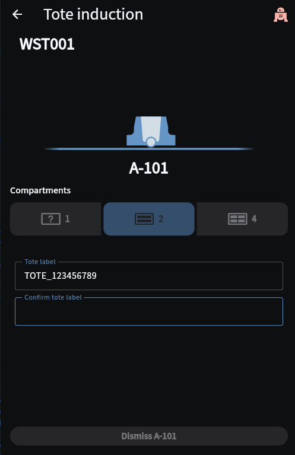

- Compartment selection is first now, since totes are automatically created after verifying barcodes
- Compartment selection and Ant dismiss buttons are disabled during in-flight operations to prevent accidental presses
- When teleporting a tote from the Orphanage, Flo will auto-select the compartment configuration for that tote
- After scanning a tote that already exists in the system (other than orphans), the warning snackbar must now be manually dismissed with the X button so you can take note of the scanned tote and its current location

## 🪲 Bug fixes
- Mantises and Ants should no longer go offline due to lack of frequent-enough MQTT heartbeats [#7410]
- The Mantis fullness calculation has been improved, which should result in better distribution of totes during Tote Induction [#7826]
- Ants should no longer take longer than expected to start moving again after dropping off a tote with inventory into a P&D [#7731] [#7813]
- Flo no longer inaccurately reports that an empty Ant is carrying a tote after presenting during Tote Induction [#7712] [#7715]
- Flo no longer allows the accidental deletion of totes after dismissing Ants during Tote Induction [#7675] [#7684]
- Totes in the Orphanage now accurately show in Flo on the Orphanage Detail screen [#7861]
- The select-all button on the Layout screen now only selects robots that are visible in the card list (excludes filtered robots) [#7860]
- Flo no longer blocks you from entering the Tote Induction Operations screen sometimes after starting Tote Induction at a workstation [#7611] [#7766] [#7808]
- Flo now shows empty compartment demand correctly, instead of as "Empty totes" [#7800]
- Flo no longer shows the "hamburger" icon for 600✕200 compartments on the Tote Detail screen [#7835]
- Compartments are now tappable from the Tote Detail screen [#7852] [#7807]
- The robots filter button is now shown on the robots side sheet on mobile [#7860]

## 💽 Firmware updates
No firmware updates required! ✅

## 🧪 Development improvements
Nothing to see here 🙈

## 🚧 Known issues
- Ants sometimes need to be manually rebooted due to infinite reconnect attempts [#7760]
- Ants sometimes overshoot their target commanded position, causing overlapping reservation gridlocks [#7820] [#7842]
- The Flo layout is a bit sluggish when tunnels are visible [#7821]
- On the Flo Area screens, incoming transfers are not visible until the first Ant arrives at the workstation [#7821]
- Workstations sometimes show as Off in Flo when Tote Induction is enabled [#7779]

## 🚀 Deployment notes
- **New robot firmware?** YES
- **New Flo APK?** v4.5.16
- **New backend services** NONE
- **Updated backend services** AVS, CVS, IMS, RMS, SASG
- **Database migrations** NONE
- **Downtime requirements** 1 hour of full system downtime

# v3.0.3 - Ant traffic school

2026.07.20

## ✨ Shiny new stuff
Sorry, just the shiny old stuff for now 〰️

## ⏫ Level-ups
### 🌭🍔 Hot dogs and hamburgers
Flo now supports both **hot dog** and **hamburger** tote compartment configurations.

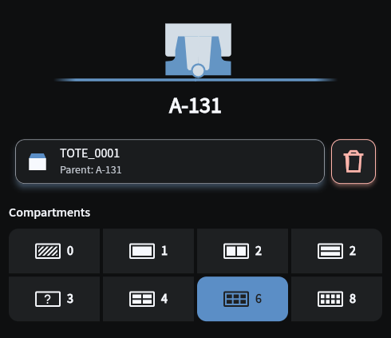

- Flo also supports fully **empty totes** without compartments, **single compartment** totes, as well as **quad**, **hex**, and **oct** compartment configurations
- Custom compartment icons during tote induction are also **bigger** so it's easier to see which compartment configuration you are selecting
- Flo will also **remember** the last compartment selection you used **by workstation** until you restart the app

## 🪲 Bug fixes
- Ants should no longer collide with Mantises while the Mantis is extracting [#7763]
- Ants should no longer fail tasks due to "Failed to find transition position for request" [#7473] [#7741]
- Ants should no longer periodically stop while driving long distances [#7743]
- Ants no longer get close enough to gridlock each other in certain cases [#7713] [#7756]
- Empty Ants should now distribute more evenly between multiple workstations based on WIP calculations [#7749] [#7729]
- Ants should no longer get stuck at the position just before the presentation position in a workstation [#7750] [#7767]
- Ants carrying totes with compartments other than the compartment types currently being requested by the workstation should now auto-dismiss after presenting [#7755] [#7775]
- Dynamic Pick Stations should now request the right number of totes and Ants [#7709]
- Totes that already exist in the system can no longer be teleported during Flo Tote Induction unless they are in the Orphanage [#7721] [#7723]
- The Flo container teleport destination selection bottom sheet should now show all eligible bays during selection [#7279]
- After creating, deleting, and re-creating a tote during Flo Tote Induction, tote compartments no longer inaccurately show DELETED in Flo [#7667]
- During Flo Tote Induction, Flo no longer inaccurately reports that an empty Ant is carrying a tote (the previous tote the Ant inducted) [#7777]

## 💽 Firmware updates
No firmware updates required! ✅

## 🧪 Development improvements
- DPS environment variables have been corrected in Helm [#7794]

## 🚧 Known issues
- The order of operations in Flo Tote Induction is a little wonky [#7727]
- Flo Tote Induction allows you to delete a tote on an Ant after dismissing the Ant [#7684]
- Compartment-specific demand shows as "Requesting empty totes" in Flo [#7800]
- Workstations sometimes show as Off in Flo when Tote Induction is enabled [#7779]
- Sometimes Flo Tote Induction is stuck in a Pending status [#7766]
- Ants sometimes take longer than expected to start moving again after dropping off a tote with inventory into a P&D [#7744]
- Sometimes compartments are not tapable in Flo and show the incorrect icon [#7807]

## 🚀 Deployment notes
- **New robot firmware?** NO
- **New Flo APK?** YES
- **New backend services** NONE
- **Updated backend services** AMS, CVS, DPS, GAS, IMS, LM, RCS, RES, RMS, RQS, SASG
- **Database migrations** See note below
- **Downtime requirements** 30 minutes of full system downtime

For the **new compartment icons** to work correctly in Flo, you'll need to make sure your container templates are configured with the following **valid labels**. Anything outside of these labels will show a ? compartment icon in Flo.
- EMPTY_TOTE
- STUDIO
- HAMBURGER
- HOTDOG
- QUAD
- HEX
- OCT

# v3.0.2 - Hot dogs for the children

2026.07.16

## ✨ Shiny new stuff
Sorry, just the shiny old stuff for now 〰️

## ⏫ Level-ups
### 🌭 Added support for "hot dog" totes [#7716]
SIMPLware now supports totes with 2 long rectangular compartments.

- See [Known issues](#-known-issues) below

### #️⃣ Children count filter in Flo
Flo has a new children count filter on the Containers screen, allowing users to filter containers by their children count.

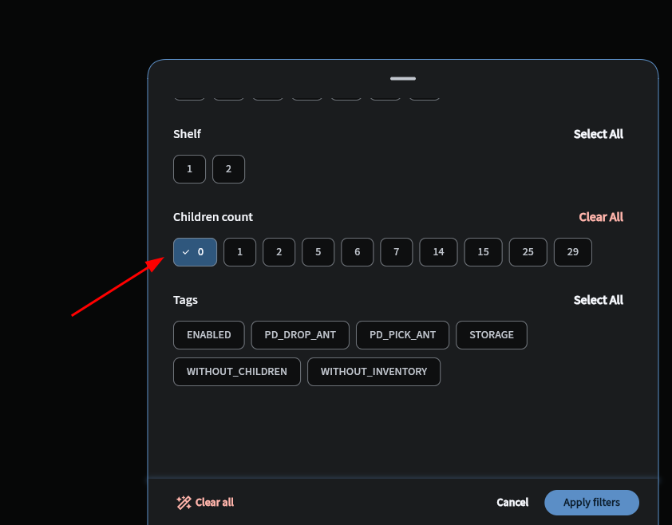

## 🪲 Bug fixes
- Reduced the number of times Ants need to be cleared while stalled in the Storage area [#7730]
- Ants no longer get close enough to gridlock each other (still) [#7738]
- Ants no longer stay unreasonably far away from each other (better command shortening) [#7711]
- Ant tasks no longer fail with "Failed to find transition position for request" errors when entering workstations [#7710]
- Flo no longer reports "Depositing to undefined" on some Ant deposit tasks [#7502]
- The time it takes for an Ant to start moving again after dropping off a tote with inventory into a P&D has been reduced [#7735]
- Pressing Enter after entering a tote label on the Containers screen now immediately searches for the tote instead of changing focus to the Find container button [#7659]
- The deletion of totes during Flo Tote Induction now properly updates other devices monitoring the Tote Induction Operations screen [#7665]

## 💽 Firmware updates
No firmware updates required! ✅

## 🧪 Development improvements
Nothing to see here 🙈

## 🚧 Known issues
Ghost town 👻

## 🚀 Deployment notes
- **New robot firmware?** NO
- **New Flo APK?** YES
- **New backend services** NONE
- **Updated backend services** AMS, CVS, DPS, GAS, IMS, RES, RVS, SASG
- **Database migrations** NONE
- **Downtime requirements** 30 minutes of full system downtime

# v3.0.1 - Couple bug fixes

2026.07.15

## ✨ Shiny new stuff
Sorry, just the shiny old stuff for now 〰️

## ⏫ Level-ups
Steady as she goes 🚢

## 🪲 Bug fixes
- Ants no longer get close enough to gridlock each other [#7677]
- Totes are now able to be correctly picked up from DPS workstations [#7688]
- Ants no longer get stuck when entering DPS workstations [#7700]
- Ants now correctly choose their closest transition nodes [#7676]
- MQTT connectivity fix for Puls analytics [#7689]
- Some SENSOR_INITIAL_STATE_CHECK_FAULT failures have been resolved [#7663]

## 💽 Firmware updates
No firmware updates required! ✅

## 🧪 Development improvements
Nothing to see here 🙈

## 🚧 Known issues
Ghost town 👻

## 🚀 Deployment notes
- **New robot firmware?** NO
- **New Flo APK?** NO
- **New backend services** NONE
- **Updated backend services** AMS, DPS, LM, POP, PUT, RES
- **Database migrations** NONE
- **Downtime requirements** 30 minutes of full system downtime

# v3.0.0 - Enter: Ant 3.0

2026.07.13

## ✨ Shiny new stuff
### 🏎️ Ants just got a lot faster [#6137]
Introducing, the new super speedy Ant management stack!

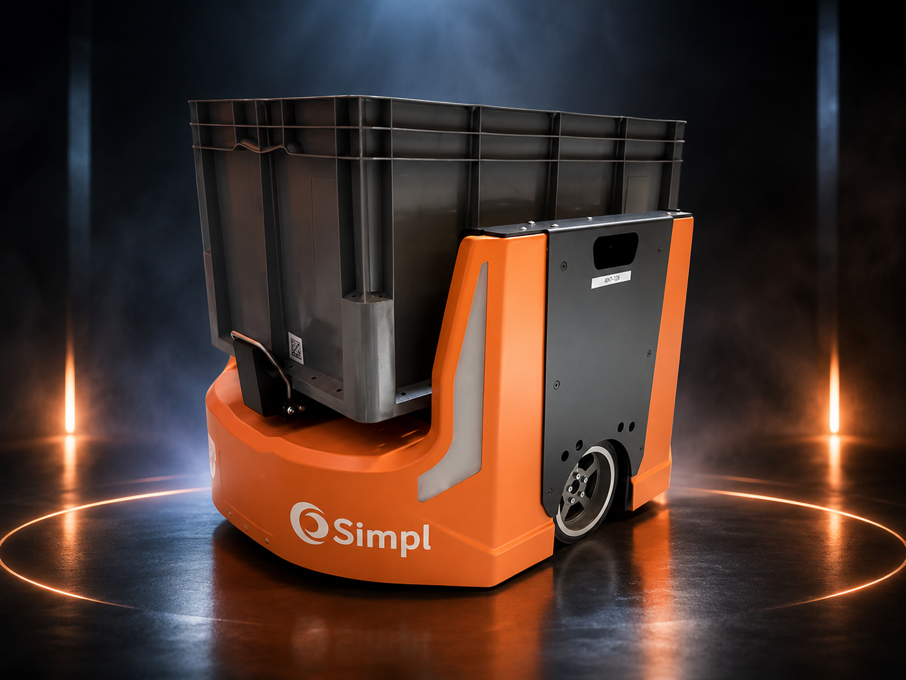

- The **time Ants have to wait** to be told what to do next has been dramatically reduced to **near zero**
- The new **Ant Management Service (AMS)** combines the functionality of robot **tasks**, **actions**, and **commands** into one, super fast, infinitely scalable, Ant conductor!
- AMS creates Ant "actors" under the hood that manage each Ant individually in memory
  - Ants are assigned to instances of AMS during deployment
  - This allows AMS to handle an **unlimited** number of Ants; the only limitation is the hardware you throw at it!
- Ant 3.0 **firmware** is more **autonomous**
  - Previously, commands were deterministic and required a final velocity to be passed
  - This resulted in commands constantly being planned and overwritten as an Ant progressed through a task
  - With the new stack, commands are planned for tasks by **appending** new commands, drastically reducing the number of commands that need to be sent to the Ants
- **Layout Manager (LM)** has been overhauled
  - LM is no longer simply an AutoCAD translator, it is a fully fledged **path planning powerhouse**!
  - Layout creation now has more accurate graph traversal according to AutoCAD properties
  - Valid orientations for traffic control are now read directly from the AutoCAD import, improving **path planning efficiency**
- **Reservation Execution Service (RES)** is a new service that exclusively handles the creation, management, and validation of **reservations** for all robots
  - Reservation management is now fully in-memory, making it **lightning fast**!

### 🗃️ Optimize product footprint with tote compartments! [#6699]
SIMPLware now enables storing many **different products** in a **single tote**!

- **Container templates** can be added to the system to configure tote compartments in a variety of ways
- Tote **orientations are tracked** as totes move around the system to enable optimized presentation at GTP workstations

### ➕ Induct totes with Flo! [#7017]
Flo has a new **Tote Induction screen** which allows users to easily induct totes into the system from GTP workstations!

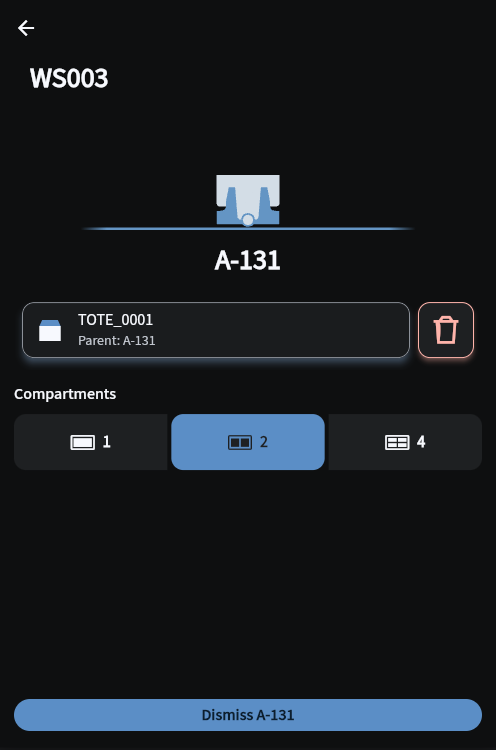

- From the **Areas screen**, select a workstation then press the **Play button** in the Tote Induction section to start requesting empty Ants to the workstation
- With Tote Induction enabled, tap the **Tote Induction card** to enter the Tote Induction Operations screen
- While on the Tote Induction Operations screen, Flo will walk you through the process of adding new totes into the system
  - Simply **scan both labels** on the tote, select your **compartment** configuration, then press the **Ant dismiss** button or scan the Ant dismiss **QR code** to send the Ant away and load your next tote!

## ⏫ Level-ups
### 👁️ Flo layout visibility [#7560] [#7559] [#7527]
The Flo Layout screen has a new expandable **visibility menu**!

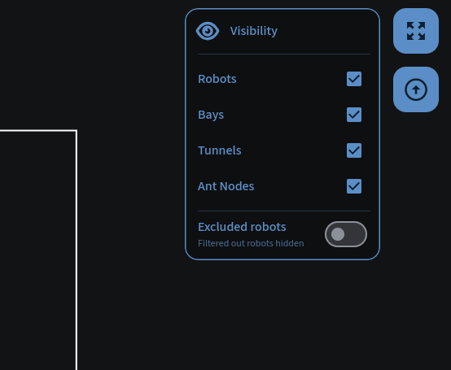

- Tap the **eyeball icon** on the Layout page to expand or collapse the new menu
- With the new menu, you can show/hide Robots, Bays, Tunnels, and Ant Nodes in the layout
- That's right, I said **Tunnels**! Inaccessible and disabled tunnels now render on the Layout screen too!
- There is also an **"Excluded robots" switch**, which, when enabled, will display all robots in the layout, even if they are **filtered out** on the robot card list!

## 🪲 Bug fixes
- Mantis homing code capture now starts correctly [#7428] [#7503]
- Totes can now be successfully picked up and dropped off at DPS stations [#7156] [#7664] [#6390] [#6731]
- Inventory updates are now processed faster [#7225]
- Workstations no longer sometimes request an incorrect number of empty totes or robots [#7463] [#7413]
- Shelf offsets are now collected more accurately [#7628]
- Ants now deposit to the closest available P&D locations [#7600]
- Offline robots turn grey in Flo [#7566]
- Flo's Areas screen and Workstation Detail screen now show accurate, up-to-date information for Areas [#7557]
- Bays on Flo's Layout page now render with the correct orientation on all layouts [#7274]
- Empty Ant incoming transfers now show correctly in Flo's Area Detail page [#7347]
- Flo no longer shows an incorrect container enabled/disabled state sometimes [#7500]

## 💽 Firmware updates
### Mantis 2.5
- NXP: `v1.11.1-1-gb56fc09`
- Wormhole: `2.1.6`
- ALL-CAN 4: `f1a3258`
- ALL-CAN 8: `a903e43`
- Arm motor: `25072501`
- Finger motor: `v33.5`
- Foot motor: `3457`
- Scanner: Unknown [#7801]

### Ant 3.0
- NXP: `v0.13.0-5-g9290418`
- Wormhole: `2.1.6`
- ALL-CAN 4: `cf2697e`
- Mover motor: `26011601`
- Lifter motor: `26031501`
- Scanner: `V1.003.0001.1.R.20250924-1894`

## 🧪 Development improvements
- Modernization of the ACAR service; converted to the SIMPL SDK [#6055]
- Modernization of the CRS service; converted to the SIMPL SDK [#3496]
- Modernization of the AVS service; converted to the SIMPL SDK [#5872]
- Our analytics platform now collects more on-site data for analysis [#7617]
- Various service changes to support the new robot tasking stack [#6700] [#7009] [#7015]
- Firmware changes to support the new robot tasking stack [#6896]
- Improved automated testing in QA [#6355]
- RAS now publishes success/failure Kafka message for robot mode change requests [#7191]
- New Kafka topics for configuring GASConfig and GASState [#6850]
- SIMPL SDK now supports Mantis containers [#7124]
- Tagging of inaccessible tunnels can now be turned off via an SASG env var [#7526]
- The state of robot queues is now exportable via a new IOCS API and internal Kafka API [#7593]
- RAS and GAS consume Kafka messages faster [#7616] [#7512]
- URS service has been deprecated [#7232] [#7224]
- Patching of existing objects in Redis has gotten faster when writer ports in the SIMPL SDK opt-in to patching [#7223]
- New Simpl Spring Redis Periodic SDK library uses Redis to help services coordinate periodic reconciliation across multiple replicas [#7109]
- RVS is now horizontally scalable [#7180]
- RAP service helps debug onboard robot issues by automatically pushing robot logs to the cloud whenever a robot fails a task [#6320]
- Flo now has a new debugging menu to enable additional logging at runtime accessible on desktop with Cmd/Ctrl+Shift+D
- RVS now throws out stale robot status updates at startup [#7415]
- Flo now shows an in progress indication while Mantis bay assignment changes are processing [#7393]

## 🚧 Known issues
Ghost town 👻

## 🚀 Deployment notes
- **New robot firmware?** YES
- **New Flo APK?** YES
- **New backend services** AMS, DPS, RES
- **Updated backend services** ACAR, AVS, CRS, CTB, CTS, CVS, GAS, GDS, IMS, ITS, LM, LVS, RAP, RAS, RMS, RQS, RSS, RVS, SASG, SOS
- **Database migrations** YES
- **Downtime requirements** 1 hour of full system downtime

<a class="archive-releases-btn" href="#/archive">🗃️ Archived releases</a>
