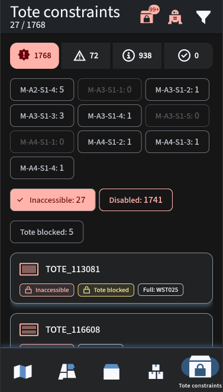
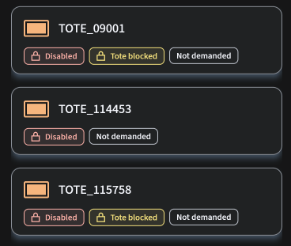
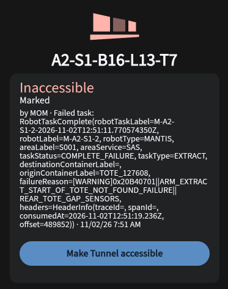
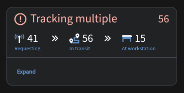
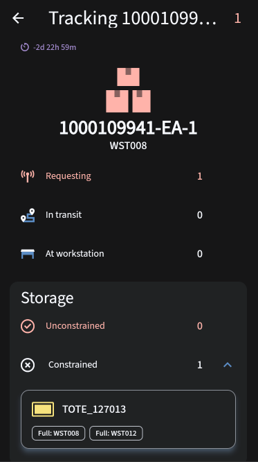
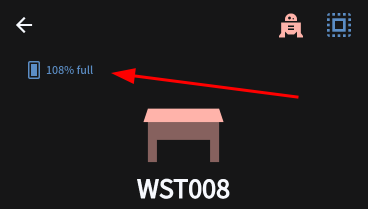
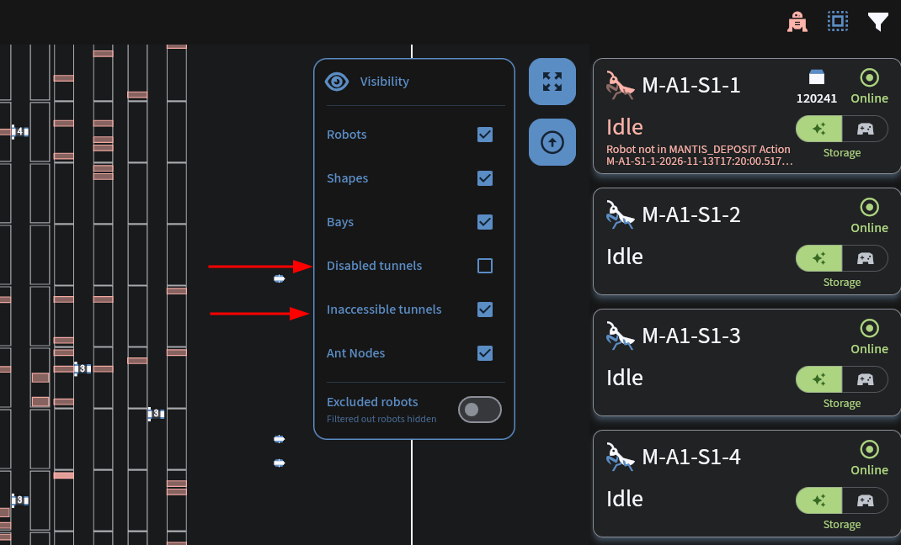
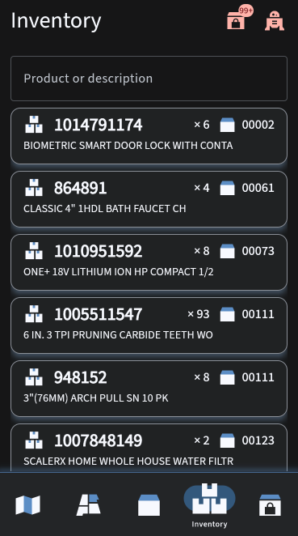
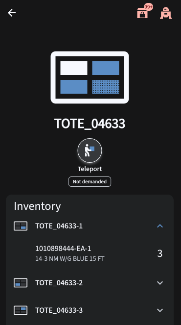

# Upcoming Release

There's a new release that will be ready soon! These release notes are **incomplete** and **subject to change**.

# v3.2.0 - Totes amazing

2026.11.11

## ✨ Shiny new stuff
### 🔎 Dude, where's my tote? [#8338] [#8727] [#8728] [#8729] [#8730] [#8731] [#9022] [#9065] [#9077] [#7647]
Flo now has **better tracking** of totes and tote issues!

- A new **Tote constraints** page sorts every tote by severity (critical, warning, low, available) with filters and counts; its app-bar icon replaces the old inaccessible-tunnels alert

- Totes get colored **chips** for whatever is holding them back: Inaccessible, Disabled or Out of purview (red), Full, Overweight or Selected for (white), and Tote blocked (yellow)

- **Tunnel and level details** show which robot and task made a tunnel inaccessible and why

- The **Workstation Detail** screen's Tracking card shows each demand's **total, in transit and at workstation** counts

- The new **Demand Detail** screen lists the totes **in transit and at the workstation**, plus which totes in storage can and can't serve the demand and why

- The **Workstation Detail** screen shows how **full** the workstation is according to the SIMPL WIP calculation

- The layout now has separate **Disabled tunnels** and **Inaccessible tunnels** toggles [#7647]

- **Mantis Detail** shows the Mantis's **next tote** based on the system's selection algorithm

### 🛍️ Inventory has come to Flo [#7805] [#8482] [#5788]
**Tote inventory** is now right there in Flo!

- A new **Inventory screen** and compartmented-tote icons and filters make it easy to find what's where

- The **Container Detail** screen shows each compartment's **products and quantities**, with compartments drawn to scale

### 🚧 Safer with Safety Gates [#8517] [#8226] [#8818] [#8611] [#8612] [#8973] [#8977] [#8613] [#8614] [#8615] [#8616] [#8617] [#8559] [#8675] [#8560] [#8992]
SIMPLware now supports **requesting entry** into Safety Zones through Safety Gates!

- There are new **Safety Zone states** in Flo with new colors to indicate each state
	- **Unsafe**: RED
	- **Lock requested**: ORANGE
	- **Safe to enter**: GREEN
	- **Occupied**: PURPLE
- When you attempt to **lock** a Safety Zone with Flo, the zone will go into "Lock requested" (**orange**) state
  - While a zone is in this state, Ants outside of the zone will be **blocked from entering**, but Ants already inside the zone will continue to complete their active tasks until they **leave the zone**
  - Mantises will complete their **active tasks** then go to their **rest positions**
  - All robots in **Manual gear** will stay where they are
- Once all Ants have **left the zone** and all Mantises in the zone are **at rest**, the zone will change to "Safe to enter" (**green**) state, letting you know it is **safe to enter**
  - While the zone is safe to enter (green), robots in Manual gear can **still be moved manually** to the desired positions
- Upon **opening the gate** to enter the safety zone, the zone changes to "Occupied" (**purple**) state
  - In this state **no robots are ever allowed to move**
- When a Safety Zone has **no Safety Gate** associated with it, or the gate is **disabled**, locking the zone moves it instantly into the occupied state, preventing any movement
- Opening a Safety Gate **always** moves the zone into an **occupied state** and **halts all movement**, regardless of whether someone requested entry with Flo
- Safety Gates are mapped to their Safety Zones and imported from the **site layout**

### 🔐 Sign in to Flo with Microsoft [#6146] [#8039] [#8348] [#8395] [#8398] [#8399] [#8981] [#8707] [#8708] [#8108] [#8758] [#8982] [#8830] [#8983] [#8750] [#9027] [#9032] [#9058]
Flo now requires a SIMPL or Home Depot **Microsoft account** to sign in!

- Every user needs a **role** to sign in, and users without one are turned away
- Who can do what is managed by **SIMPL admins**, with no Entra changes needed
- Changing a robot's **gear** is now gated behind a permission [#9027]

## ⏫ Level-ups
### 🦾 Init E-stopped Mantises from Flo [#8767]
You can now **init an E-stopped Mantis** right from Flo!

### 🚦 Ant traffic keeps up at peak [#8713] [#8733] [#8734] [#8997] [#8018]
Ant traffic now **keeps up at peak volume**!

- Subgrid reservations now run in the new **Subgrid Reservation Service (SRS)**, so RES no longer bogs down as more Ants hit the floor
- Ants **roll the moment the path clears** after a gridlock or Safety Zone block [#8018]

### ⏱️ Urgent totes first [#8843] [#8678] [#8984] [#9046] [#9123] [#9024] [#9137] [#9139]
Ants now bring the **most urgent tote** to the workstation first!

- Totes that are **due now** jump to the front of the line, and storage ranks totes the same way MOM does [#8843] [#8678]
- Totes hit **top priority 30 to 60 minutes before they're due**, so there's time to finish them on time [#9046]
- Ants pick the most urgent tote waiting at the P&D [#8984] [#9123]

### 🧩 Every shelf back in play at tight workstations [#8458]
Workstations with tightly packed shelves can now use **every shelf** again! When an Ant reserves a shelf, its **neighbors are reserved too**, so Ants never squeeze in side by side and gridlock.

### 🧭 Teleported totes face the right way [#8482]
Teleport a tote and tell Flo which way it faces!

- When you **teleport** a tote that holds inventory, Flo shows its compartments and asks which way it should **face**
- SIMPLware remembers the direction you pick, so the right compartment is presented to the operator at the workstation afterwards

### 📥 Smarter putaway [#8264] [#8724] [#8273] [#8274] [#8453] [#8647] [#8658] [#8978] [#8120] [#8907]
Inbound totes now go to **the best spot**, not just the first open one!

- Ants pick the inbound **P&D** by weighing how full each Mantis is, how busy the workstation is, and how far away it is
- Mantises store inbound totes **along the way** to the next tote they need to fetch, cutting travel and setting up more dual cycles
- Totes coming in from a P&D are stored **close to that P&D**, instead of on any empty shelf [#8907]
- New aisles can be limited to **empty totes only** for putaway [#8724] [#8658] [#8978]

### 📊 Puls data you can count on [#8377] [#8266] [#8286]
Puls dashboards stay complete and up to date, even through outages!

- Puls dashboards **catch up on their own** after a database or network drop, instead of missing data [#8377]

### 🪵 Bot logs land when you need them [#8285] [#8287] [#8451] [#8855]
When a robot has a problem, its logs are there to dig into!

- Pulling a robot's logs for a task failure no longer holds up a full log pull for that robot, and vice versa [#8285]
- You can pull a **whole day's** logs for a robot in one go [#8287]
- When a robot **drops off the network**, its logs are pulled as soon as it's back [#8451]
- Log pulls that were waiting on a robot to reconnect are no longer lost when the bot log services restart [#8855]

### 🕐 Times that make sense [#9033]
Every time in Flo now shows in **12-hour format with AM/PM**!

### 🗃️ Storage tote loading has a new home [#8706]
**Storage tote loading** now lives in the overflow menu on Flo's **Containers** page

## 🪲 Bug fixes
- Ants no longer gridlock after replanning around a blocked path; a new RES setting lets them stop further back from the blocking Ant [#8908]
- SIMPLware no longer slows down or stops because Kafka's disks fill up or Redis runs out of memory: old robot messages are now cleaned up, and Kafka and Redis get more CPU and memory [#8961] [#8996] [#9056] [#9049]
- Totes are spread more evenly across workstations, and a workstation is no longer left waiting after a cancelled or failed transfer [#8537]
- Mantises are no longer sent to fetch a tote right after it's tagged ineligible, like when it's quarantined [#9075]
- Ant tasks no longer occasionally fail when the Ant is already sitting on its destination [#7456]
- The Flo Layout screen no longer has missing bays after a dropped connection [#8872]
- Deployments on large sites are faster now that the Layout Manager (LM) service no longer works out every travel distance at startup [#8425]
- SIMPLware no longer misses upstream data like workstation demand requests due to some intermediate network issues [#8657]
- During multi-aisle Tote Migration, Ants no longer wait under P&Ds after dropping off totes waiting for a new tote migration tote to pick up [#8868]
- At sites with more than one storage area, totes now always come from the storage area the work was assigned to [#8659]
- Ants will now charge during Tote Migration [#8895]
- When many Mantises are idle at once, like at shift start, they no longer wait as long to be given new work [#8871]
- Grafana log dashboards no longer get stuck showing no recent logs when one of the Loki log readers stops responding [#8963]

## 💽 Firmware updates
### All robots
- Wormhole: TBD

### Ant 3.0
- NXP: `0.20.0`

## 🧪 Development improvements
- Added a RES endpoint to update subgrids, carrying existing reservations over to the new subgrids [#6595]
- LVS is rebuilt on the SIMPL SDK and now sends Ant positions and Safety Zone reservations to Flo in pages [#5789]
- Automatic Ant replanning after a task or command failure can now be turned off with the new AMS `autoReplanOnFailure` setting (on by default) [#8916]
- Ant firmware now logs both command labels when it rejects a command for an invalid label, making those errors easier to trace [#7757]
- The RSS simulator now runs Ant commands at realistic speeds instead of a fixed one-second delay [#7955]
- MOM can now run as multiple copies at once to share the load [#8986] [#8987]
- Tote reservations are now managed only by CRS instead of being shared with MOM [#8134]
- Cleaned up the shared Flutter libraries behind Flo, removing workarounds and adding screenshot tests for its widgets [#8144]
- Robot Wormhole images now include full vim with color support, so color-coded logs are easy to read on the robot [#8814]
- `kpf` port-forwarding now uses non-standard local ports, so it no longer clashes with other apps on your laptop (for example, the Grafana login redirect) [#8962]
- Large Redis backups can now be restored without the copy timing out partway through [#9053]
- Flo now reads its layout name from site config like the other services, instead of having it built in per site, so one site can run different layouts across environments [#8976]
- Puls dashboards are now version-controlled and deployed through a repeatable process [#8359]
- Puls tables are now set up so site contributor roles can write to them without a manual permissions fix [#8877]
- Groundwork for **support tickets in Flo**: the code for the new POFS, SSS, RGZ (Zendesk) and RGADO (Azure DevOps) services and the Flo support screens is in place, ready for the launch in 3.3.0 [#6604] [#8145] [#8985]

## 🚧 Known issues
- Flo's Extract on the Robot Detail screen accepts a shelf location instead of a tote ID, and the robot then pulls out the shelf itself [#8866]
- Robots can sometimes stay offline after a short 4G drop until they're power cycled [#8313] [#8199] [#8411]
- Robots can sometimes sit on a task without moving until they're cleared, blocking other robots [#8147]
- Ants can sometimes form 4-way gridlocks [#8109]
- Mantises can sometimes gridlock with each other or with Ants [#8038] [#8040]
- After converting multi-compartment totes to 1-compartment, empty 1-compartment totes often aren't brought to decant workstations [#8667]
- After RVS starts, some Mantis robots can appear without bay assignments until statuses catch up [#8599]
- CTS sometimes takes a long time to update container tags [#6576]
- An Ant's battery level can jump up or down when it connects to or leaves a charger [#8383]
- A Mantis in Manual mode won't make a second move to a DM code in a row until it's switched to Auto and back [#8404]
- Orphaned totes can't be inducted from a Flo device, which shows "container with the same label already exists" [#8059]
- Flo doesn't show a Mantis anti-pinch rear fault [#8085]
- Workstations sometimes show as Off on the Flo Workstation and Workstation Detail screens when Tote Induction is enabled [#7779]
- Ants never show in "Moving" state [#7294]
- The on-screen keyboard cannot be used during Flo Tote Induction [#7905] [#7907]
- Pressing Escape on the Flo Tote Induction screen does not return to the Workstation Detail screen when the tote label field has focus [#8342]
- Flo shows "Invalid label format" when opening the bays of some workstations, like WST025 [#8067]
- On the Flo Containers screen, when lots of filters are selected, there is no room on smaller screens for the tote cards [#7851]
- Old robot logs aren't always cleaned up, so a robot's SD card can fill and stop saving new logs [#8995]

## 🚀 Deployment notes
- **New robot firmware?** YES
- **New Flo APK?** YES (version TBD)
- **New backend services:** SRS, SVS, USA
  - Deploy **SVS before CVS**, so Flo never loses tote tag info [#8730]
  - Deploy the sign-in services in this order: **Auth Kafka** (then Auth Kafka UI if wanted), **Auth Redis**, **USA**, then SIMPLware [#8398] [#8399] [#8981]
  - One-time per site before that: cert-manager, the `simpl-auth` namespace, the Auth Kafka certificate and login secrets, and a **multi-tenant** Flo Entra app with the site's redirect URIs and tenant admin consent [#8707]
- **Updated backend services:** ACAR, ADAS, AMS, AVS, CRS, CTB, CTS, CVS, DPS, GAS, IMS, IOCS, ITS, LM, LVS, MOM, POP, PUT, RAP, RAS, RES, RSS, RVS, SASG, SOS, TOM, WDS
  - Redeploy **Loki** with `hdeploy loki` so log dashboards recover on their own [#8963]
  - On its first start, **CVS** rebuilds its container views on its own; let it finish before using Flo [#8482]
- **Database migrations:** NO
- **Helm configuration changes:** YES
  - New **auth plane** in the `simpl-auth` namespace: **Auth Kafka** (TLS + SASL, with an optional locked-down Auth Kafka UI), **Auth Redis** (TLS + ACLs) and **USA**, each as its own Helm release [#8398] [#8399] [#8981]
  - **USA** is no longer part of the SIMPLware umbrella chart; it deploys on its own with `hdeploy usa`, and its blocks are removed from site configs [#8981]
  - Flo's Entra settings move to a **multi-tenant** app so users from every allowed tenant can sign in [#8707]
  - New **SVS** chart [#8728]
  - New **SRS** chart [#8733]
  - **SOS** Safety Gates are now set through Helm, with no gates configured by default, so sites with Safety Gates must add them to their config [#8977]
  - New **RES** setting for how far back an Ant stops from a blocking Ant after replanning [#8908]
  - Flo web must be served over **HTTPS on port 443** so Microsoft sign-in works, and it then connects to MQTT over secure WebSockets [#8108]
  - New **AMS** `autoReplanOnFailure` setting (on by default), and env vars to override **TOM**'s tote scoring weights [#8916] [#8843]
  - **LVS** now points at the writable RMS Redis instead of a read-only replica, or it won't start [#8973]
  - **Loki** read pods get a liveness probe, so a stuck one restarts on its own [#8963]
  - Redeploy **Kafka** and **Redis** (`hdeploy kafka`, `hdeploy redis`) to pick up the new Ant topic retention and the bigger CPU and memory settings [#8996] [#9056] [#9049]
  - New Flo setting for the **sign-in timeout** (default 30 seconds) *(In Dev)* [#8983]
  - THD sites still on the interim layout must set Flo's layout name (`env.layoutName`) to `THD_Pilot_Interim` before deploying, or Flo will show the full `THD_Pilot` layout [#8976]
- **Downtime requirements:** 6 hours full system downtime for infrastructure upgrades, SIMPLware deployment, and post-deployment validation
